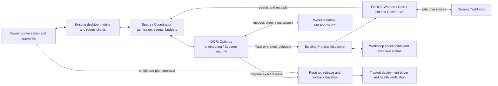

# IGOR and FORGE: conversational engineering and security

Implemented locally, 27 October 2026. This extends renovated Mark VI, leaving
the original `first` and `final` applications unchanged. It supersedes the older
statements in ORCHESTRATION.md and LEGION.md that FORGE must wait for a supervisor
contribution to finish before execution begins.

## Authority and working execution path



Speda retains overall coordination. IGOR's named specialists own conversations,
reasoning, requirements, delegation, supervision and acceptance. FORGE is the
identity-free execution module already imported into Mark VI. It has no competing
conversation engine, owner-memory writer, scheduler or independently enlarged
budget. Optimus assigns Autobots/reviewers; Scourge assigns Decepticons/reviewers;
Speda retains its existing cross-team orchestration authority. Ordinary reasoning
and lightweight tasks use the specialist's direct answering loop without FORGE.

The stable mission identity is the existing room/project binding. Workshop's
versioned project checkpoint retains objective, acceptance, progress, checks,
blockers and next steps. ProjectTask records retain assignments, exact artifacts,
dependency lineage and the original run's authority. No duplicate mission queue
or second checkpoint authority was introduced.

## Conversation and execution proceed independently

1. The existing registry commits the supervisor's tool receipt. Coordinator then
   kicks the project's dispatcher as soon as it delivers that tool result.
   FORGE can inspect, edit, run commands and test while IGOR continues speaking.
2. A per-run dispatcher lock and task-status CAS prevent duplicate local claims.
   A cooperative project lock serializes writers across simultaneous chat rounds;
   Workshop's durable exclusive source/artifact claims remain the final fence.
3. Finishing a public round releases the conversation while workers continue under
   their original lease, deadline, provider/thinking snapshot and root budget.
   Disconnecting/reconnecting transport does not own or restart execution.
4. A later owner turn receives a bounded attributed mission packet for that
   specialist's assignments in the same room. `legion_inspect` reads detailed
   progress/results, and `legion_control` steers or stops the existing execution.
   Additional assignments may depend on existing tasks from earlier turns in the
   same room and project, consuming the new assignment's admitted budget.
5. After a completed artifact, an enabled supervision pass creates an attributed
   IGOR AgentStep within the original run. It uses the same answering loop,
   registry, contribution allowance, paid receipts and deadline. The supervisor
   can inspect evidence, record `project_review`, request exact-artifact review,
   or delegate scoped corrections. A root still permits at most eight combined
   assignments. Missing allowance leaves acceptance visibly pending.

`PROJECT_SUPERVISION_ENABLED=true` is the default when project execution is
enabled. Tests that assert legacy scripted call order explicitly disable this
additional acceptance pass. Project execution itself remains disabled by default.

## Steering and safe boundaries

Two different durable inboxes preserve the intended recipient:

- `POST /coordination/runs/{id}/input` and the existing `/chat/steer/{request_id}`
  address the active IGOR supervisor. The owner input is not automatically
  broadcast to every worker. IGOR interprets it and routes relevant changes with
  its existing supervisor tools. Input arriving during a final answer is checked
  before completion, so it can continue that reasoning exchange.
- Existing `/legion/executions/{id}/messages` and `/coordination/tasks/{id}/input`
  address a specific FORGE worker. Owner and supervisor inputs retain their
  attribution; supervisor messages do not confer additional owner authority.

Inputs have idempotent IDs and distinct queued, delivering and delivered states.
Delivered means included at a legal model boundary, not obeyed or verified.
Before each new FORGE model call, queued instructions enter a valid protocol
message. At each pre-effect gate, pending steering refuses a stale tool request
with a recorded result and lets Warden replan. A command already in progress
reaches its existing cancellation/timeout boundary; steering does not mutate a
half-completed tool exchange or claim it rolled back that command.

Supervisor boundaries retain the full reasoning transcript and next paid-call
index alongside input-delivery receipts. FORGE exchange checkpoints retain the
portable transcript, native continuation state, paid-call index and artifact
revision. Native continuation data remains internal, excluded from client events
and owner-memory evidence. Checkpoints aid inspection/reconciliation; they do not
prove that a dead executor's Cell stopped or authorize automatic replay.

Later owner rounds and their assistant responses are excluded from the earlier
run's conversation history. Explicitly steered task input is the intended path
for updating an existing worker. Stop-reply, stop-worker and stop-run keep their
separate scopes; unrelated children are not cancelled by stopping a reply.

## Execution evidence and acceptance

The existing FORGE loop, provider adapter, command tools and Docker Cell perform
the work. There is no fake command runner or success-by-interface path. Provider
responses persist before exposing tool requests; effects persist started receipts
before execution and completed receipts afterwards. Command checks retain before
and after content revisions and actual results. Event persistence failure stops
execution; it is not silently ignored.

`project_review` records a versioned assessment by the actual assigned supervisor
in the same conversation, even on a later turn. It validates the current retained
artifact against the exact completed revision. Referenced checks must belong to
that task; accepted checks must have passed on that revision. An empty check list
is an assessment without claimed command verification, not fabricated test proof.
Supervisor acceptance never grants publication permission.

`project_checkpoint` lets IGOR update the existing Workshop plan with its current
revision/CAS contract. Planning writes retain supervisor attribution. Declaring
completion checks durable project tasks and their exact-revision assessments;
it cannot hide pending work by relying on a truncated mission packet.

Existing authenticated room SSE, execution SSE, monotonic event sequence and
cursor replay remain the stream authority. Both desktop clients and Android keep
their worker-detail controls. Heartbreaker's active composer now addresses IGOR's
real inbox. `/rooms-ui` shows execution events, repeatable worker steering,
supervisor input receipts, artifact assessments and release-plan review.

The authenticated `/legion/sessions/{session_id}/attach` stream projects all child
activity and supervisor assessments for one conversation. Both desktop clients
keep that single connection open independently of public replies, including while
a later reply streams. Existing event IDs and sequence folding prevent duplicate
text. Closing a child detail pane does not stop background feedback; reconnecting
never launches an executor. Android retains its existing per-worker attachment
and controls; automatic session-wide streaming there remains unverified.

Desktop recovery first reads `/legion/sessions/{session_id}/snapshot`, then replays
from its overlap-safe room cursor. Stable parent identities, selected-chat fences,
sequence-aware history merging and bounded/coalesced previews preserve activity
through reloads and chat changes. Heartbreaker supplies an expected supervisor
step and stable steering input ID; late acknowledgments preserve newer drafts.
The [Heartbreaker reliability review](HEARTBREAKER_RELIABILITY.md) records the
pinned Codex/Open WebUI source comparison, regression coverage and limits.

## Concrete publication and human approval

The default empty `PROJECT_RELEASE_TARGETS_FILE` disables publication. A trusted
operator may configure a host JSON file, outside worker-mounted repositories:

```json
{
  "staging": {
    "description": "Publish the reviewed application to staging",
    "deploy": ["/usr/bin/python3", "/opt/speda-drivers/publish.py", "{workspace}", "{release_id}"],
    "verify": ["/usr/bin/python3", "/opt/speda-drivers/check_release.py", "{release_id}"],
    "environment": ["STAGING_DEPLOY_TOKEN"],
    "timeout_seconds": 120,
    "rollback_instructions": "Use the trusted rollback driver to restore the previous deployment; verify its release identity. Retain the failed release and canonical baseline."
  }
}
```

Executables must be existing absolute files. Argv is executed without a shell;
only whole-token `{workspace}`, `{release_id}` and `{project_id}` substitutions
are supported. The operator controls the driver, its dependencies, target
credentials and rollback procedure. The verifier must check the deployed release
identity and application health. Drivers must not execute untrusted build hooks
with privileged credentials. Build/test work belongs in isolated FORGE Cells.
This is a trusted host deployment boundary, not an additional sandbox.

`project_release` requires acceptance of the exact artifact. Preparation retains
a separate release copy and canonical rollback baseline, content manifests,
bounded unified diff with explicit omission notices, assessment, deployment argv,
health argv, environment names, rollback instructions and a one-hour plan hash.
Preparation makes no deployment call. Changed artifact/source/target/review or
expired approval requires a new plan.

The owner reads `GET /coordination/releases/{id}`, then sends its exact hash to
`POST /coordination/releases/{id}/decision` with `decision: approve|reject`.
Neither FORGE nor an IGOR model has an approval tool. Existing `/agents/asks`
projects these native release plans to desktop/mobile approval trays using an
exact operation-and-hash handle. Remembered approval is refused. Striker now
mounts that existing approval UI too; no retired peer dispatch is restored.

The approved operation commits an executing receipt before starting the real
subprocess. Deploy and health commands must both exit successfully for completion.
Output is bounded and named environment values are redacted. Approval retries
return the saved state and never redeploy. Failed health, timeout, cancellation or
unknown process outcome holds the project deployment for reconciliation. Startup
turns a prior executing deployment into reconciling and never sends it again.

`POST /coordination/releases/{id}/reconcile` is owner-only. It requires the exact
plan hash, explicit confirmation that the prior driver stopped, an external
outcome and concrete operator evidence. Marking published also runs the original
trusted verifier. Rolled-back/failed outcomes close as failed, retaining their
evidence and snapshots. Driver-stop confirmation is an owner attestation, not an
automated discovery. External rollback is operator/target-specific; existing
ProjectLifecycle integration/rollback continues to manage canonical source copies.

## Recovery, configuration and limits

All additional tables are additive under existing metadata initialization:
SupervisorInput, SupervisorBoundary, ForgeBoundary and WorkerReview. Original
messages, memory records, project files and rollback copies are retained. No
production migration, deployment, credential change or dataset cutover occurs as
part of this local implementation. n8n remains the only recurring scheduler.

Lost leases and uncertain paid/tool/Cell outcomes remain reconciling. Existing
safe parent receipt replay remains available where its authority/deadline permits;
project execution is not resurrected by reconnect or startup. Completed artifacts
can seed a later bounded assignment through explicit dependency lineage. Full
automatic continuation of a crashed Cell still requires independently verified
teardown/effects and is deliberately not claimed by a saved checkpoint alone.

Workers retain Docker isolation, denied networking, bounded project snapshots,
restricted roles and no owner credentials. Dependencies/images must be provisioned
in the trusted Cell image (`PROJECT_CELL_IMAGE` optionally selects it); this implementation does not silently enable network
access for package installation or external security scanning. Repository size
limits and the existing thirty-iteration safety guard remain effective. Very
long work is split into checkpointed assignments under finite admitted budgets.

Local tests exercise real Coordinator/registry/provider-adapter/Warden paths with
fixture providers, durable SQLite, concurrent conversation and FORGE dispatch,
cross-turn steering, effect fencing, transcript restoration, bounded acceptance,
review/source/target drift and real local deployment/verification subprocesses.
The existing broader suite covers role isolation, exact-artifact dependencies,
receipts, clients and cancellation. Docker is unavailable on this development
host. Live Docker, paid-provider quality, real external deployment/rollback and
full desktop/mobile visual acceptance remain release gates. Claude Code-level
quality or production readiness is not inferred from passing fixture tests.
