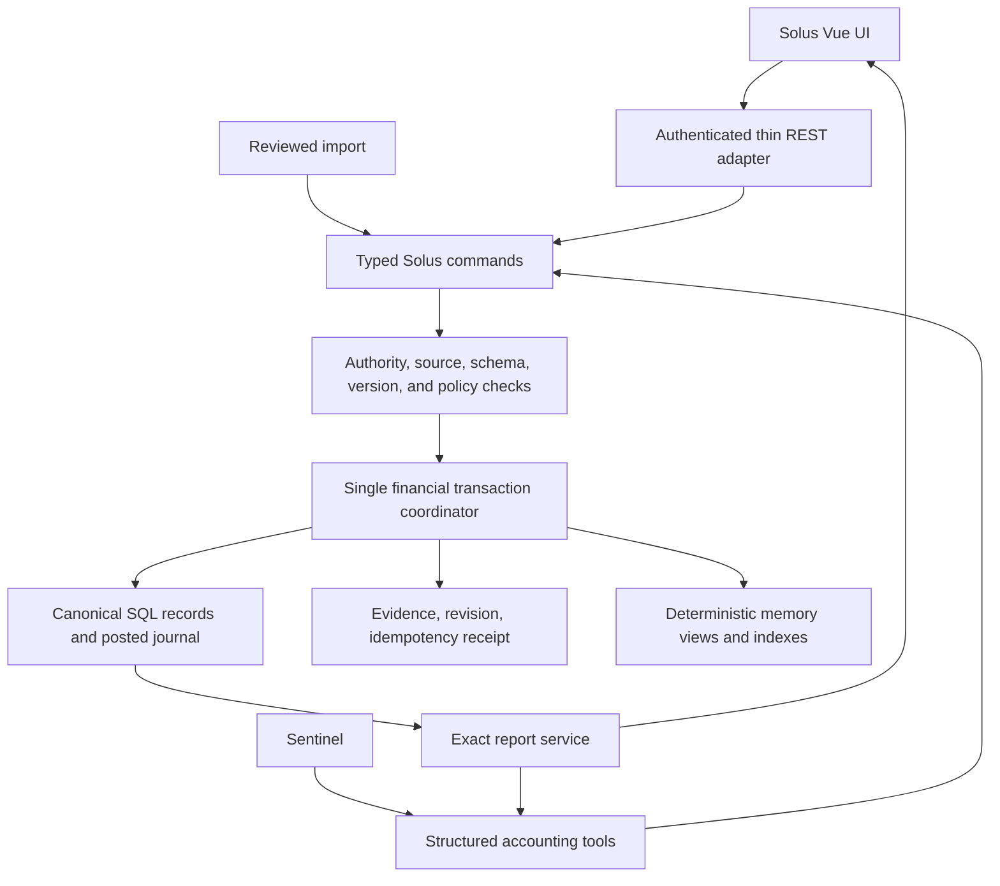

# Solus: accounting engine and owner workspace

Date: 10 October 2026; implementation update 11 October 2026.
Status: **initial implementation validated; this document remains the target architecture, not a claim that every proposed extension has shipped**.

The owner subsequently authorized implementation and deployment at
`https://speda.spedatox.systems/solus`, requested password login/change and
UI-configurable card closing/due dates, and reserved historical migration and
legacy retirement for himself. See `docs/SOLUS_ACCOUNTING.md` for implemented
workflows, security, operating instructions and explicit limits.

Owner-selected scope: **personal finances plus freelance and small business**.
Solus keeps its standalone UI. It becomes the authoritative accounting subsystem
inside Igor, with Sentinel and the UI using the same commands and reports.

This plan replaces the prototype design, not the deployed financial dataset.
This document alone does not authorize production migration or cutover.
The later owner instruction authorizes the Solus deployment; it does not
authorize converting historical records or retiring the legacy writer.
The current memory contract applies until the corresponding code, migration,
tests, and contract amendments have shipped together.

## 1. Product decisions

1. One SQL authority for financial events. Markdown is a readable projection.
2. Double-entry underneath; ordinary financial actions in the UI and agent tools.
3. Actual events, evidence, obligations, forecasts, and valuations remain distinct.
4. Exact money, explicit currencies, reproducible calculations, and explainable reports.
5. Every posted change has a source, stable identity, receipt, and history.
6. Personal and business books are separate. Consolidation requires an explicit policy.
7. A standalone, compiled Vue UI at `/solus/`, with a Heartbreaker entry point.
8. SQLite remains Igor's database. No separate accounting server or database.
9. n8n remains the sole scheduler. Reports and forecasts compute on demand.
10. Features become available only when their full workflow passes acceptance checks.

"Every use case" means a coherent foundation and tested workflows within the
selected scope. Unsupported operations return an explicit capability response;
they never become generic expense rows that silently change accounting meaning.
Inventory manufacturing, payroll calculation, statutory filings, bank payment
execution, and jurisdiction-specific compliance are separately specified extensions.
Ordinary payroll deposits and business purchases can still be recorded.

## 2. What the owner can do

| Workflow | Required behavior |
|---|---|
| Cash or bank expense | Categorize and split a purchase; record the paying account and source |
| Income | Separate earnings from loans, refunds, gifts, and owner contributions |
| Account transfer | Both sides of one event; fees separate; never ordinary income/spending |
| Card purchase | Recognize the purchase and card liability once |
| Card repayment | Reduce liability and bank balance without creating a second expense |
| Installment purchase | Explicit first due date, exact allocation, schedule revisions, linked settlement |
| Loans | Separate principal, interest, fees, disbursement, and repayment |
| Bills and subscriptions | Rule, generated occurrence, obligation, and actual payment are distinct |
| Refund or chargeback | Link to the original event; support partial amounts and disputed status |
| Shared purchase | Record the expense and the recoverable amount owed by another person |
| Reimbursement | Settle the receivable; do not classify settlement as fresh earnings |
| Foreign currency | Keep native amounts; explicit rate, fees, and conversion valuation |
| Opening balance | Evidence-bound opening entry; no invented historical income |
| Statement reconciliation | Match imported rows, compare statement balance, show discrepancies |
| Budgets and goals | Compare against an explicit spending basis; include/exclude commitments visibly |
| Freelance invoice | Draft, issue, partial payment, overdue, credit note, settlement |
| Supplier bill | Amount owed, due date, partial settlement, corrections |
| Tax components and withholding | Explicit configured amounts/rates, effective dates, liability/credit tracking, evidence |
| Owner funding/draw | Equity movement; separate personal/business counterpart events |
| Asset and investment tracking | Cost, quantities/lots where supported, fees, valuations, realized/unrealized distinction |
| Historical import | Preview, reconcile duplicates, preserve sources, quarantine uncertain claims |
| Correction | Revise drafts; reverse and replace posted financial effects |
| Reports/export | Drill down to journal events and evidence; preserve report basis and revision |

## 3. Accounting semantics

### 3.1 Books, accounts, events, and postings

A book belongs to the authenticated owner and has a functional currency,
timezone, fiscal calendar, chart of accounts, and reporting policy. Start with
one personal book; create business books explicitly. Profile identity is not book
ownership. A request cannot select another owner's book or account.

Accounts use the five basic types: asset, liability, equity, income, expense.
UI categories are income/expense accounts with friendly names. Bank accounts,
cash, cards, receivables, payables, loans, and opening equity are explicit accounts.
Monetary accounts have a fixed currency; changing that currency after posting is
forbidden. Group accounts are not posting targets. Accounts with history can be
closed, not deleted. Hierarchies must be acyclic.

An event represents an economic occurrence. Its posted journal has at least two
nonzero lines, each with a side and a positive integer magnitude. Debits equal
credits per currency. Functional-currency valuations also balance when present.
Cross-currency operations use explicit FX/trading lines; a TRY debit and USD
credit cannot satisfy the same balance check by adding their numbers.

Balance checks apply to the complete journal at posting time. Database triggers
and constraints protect posted immutability and the transition to posted;
service checks provide useful errors. Tests exercise direct SQL attempts as well
as commands. SQLite-compatible enforcement is required, not assumed from ORM types.

The five account types support both personal and business workflows; see the
maintainer's [GnuCash account model](https://www.gnucash.org/docs/v5/C/gnucash-guide/chapter_accts.html).
The choices in this document are Solus's proposed design.

### 3.2 Worked example: the 6,000 TRY shoes

Purchase date: 10 October 2026. First installment due: 15 November 2026.
Three installments, no separately stated financing charge.

| Event/view | October | November | December | January |
|---|---:|---:|---:|---:|
| Purchase expense recognized | 6,000 | 0 | 0 | 0 |
| Scheduled obligation | 0 | 2,000 | 2,000 | 2,000 |
| Actual bank outflow | 0 | Only a recorded payment | Only a recorded payment | Only a recorded payment |

Purchase posting: debit shoes expense 6,000; credit card liability 6,000.
A confirmed payment: debit card liability 2,000; credit bank 2,000.
Payment changes settlement state and cashflow, not the original purchase amount.
Statement allocation must distinguish an installment becoming due from the
card account receiving a payment. A card payment can settle multiple items.

An invoice similarly creates a receivable and recognized revenue when issued
under the book's policy; collecting it settles the receivable. A cash-basis report
uses explicit settlement allocations rather than counting issuance and receipt twice.

### 3.3 Actuals, observations, and missing knowledge

- Planned entries and schedule occurrences never enter posted actual totals.
- A bank balance observation is a dated measurement, not a ledger adjustment.
- Reconciliation differences do not silently become expenses or opening equity.
- Unknown amounts/accounts/dates remain null or unresolved in intake records.
- A missing occurrence date retains `reported_on` and evidenced date precision.
- Month-only claims can appear in a clearly labelled period-precision activity
  report; they cannot assert an exact daily balance or pass exact-date reconciliation.
- Incomplete claims stay in the review inbox. Migration preserves them and labels
  any changed report eligibility; no fabricated counterpart is silently posted.
- Conflicting statements survive as separate source assertions linked to an issue.

## 4. Exact arithmetic and dates

Persist monetary amounts as signed-64-bit-compatible integer minor units plus an
explicit currency/scale definition. Commands accept canonical decimal strings;
the service validates and converts them exactly. JSON returns amount strings or
minor-unit strings so JavaScript cannot lose integer precision. UI calculations
use exact integer/decimal arithmetic; chart coordinates are display-only numbers.

SQLite REAL values are approximate; declaring `Numeric(12, 2)` is not an exact
decimal storage guarantee. See [SQLite's numeric precision documentation](https://www.sqlite.org/floatingpoint.html).

Reject nonfinite numbers, ambiguous separators, unsupported scales, excess
decimal places, excessive amounts, and overflow. Currency metadata is versioned;
each posted amount retains its scale. Support different currency precisions.
Quantities, unit prices, interest rates, and exchange rates use bounded canonical
decimal strings with Decimal calculations, not binary floats.

SQLite amount columns require integer storage checks as well as range checks.
Aggregations must preserve exactness when a report exceeds a 64-bit sum: use
exact Python integer accumulation over bounded pages within one read snapshot
where necessary. Never fall back to SQLite `total()` or a floating-point cast.

Rounding occurs only at documented posting/allocation boundaries. Every result
records the policy version, input rates, source, and effective date. Explicit
rounding postings make residuals visible. Reports never invent an FX rate.

Default equal installment allocation uses integer `divmod(total_minor, count)`:
each installment receives the quotient, and the first remainder installments
receive one additional minor unit. Their sum equals the original total; none is
negative. Tiny totals can produce zero-value schedule items, shown explicitly;
zero schedule items do not create zero journal postings. Custom lender schedules
must sum to the agreed amount and retain their supplied source.

Occurrence date, booking date, value date, due date, statement period, observed
date, and recorded timestamp are distinct fields. Store instants in UTC and use
the book/owner timezone at the boundary. Monthly recurrence preserves its anchor
day, with an explicit clamp-to-month-end rule, so February does not drift later
payments to the 28th. Business-day adjustment requires a selected calendar.

## 5. Canonical data model

Names below are proposed table families, not permission to build everything in
one commit. Each family is introduced in its implementation phase.

| Family | Responsibilities and integrity |
|---|---|
| `solus_books` | Owner, scope, currency, timezone, policy, version, authority epoch |
| `solus_accounts` | Book-scoped chart, type, currency, parent, closed state |
| `solus_parties` | Stable customer/supplier/lender identity, optional existing entity link, issued billing snapshots |
| `solus_events` | Stable occurrence ID, kind, lifecycle, source identity, dates, revision |
| `solus_journals`, `solus_postings` | Immutable posted snapshots, balance checks, event linkage |
| `solus_sources`, `solus_evidence` | Immutable originals/references, hashes, owner scope, exact quotations |
| `solus_commands`, `solus_revisions` | Idempotency identity, canonical payload hash, durable receipt, actor, history |
| `solus_issues`, `solus_assertions` | Unresolved/conflicting claims and excluded historical evidence |
| `solus_schedules`, `solus_schedule_items` | Versioned agreements and expected obligations, never payment proof |
| `solus_settlements` | Payment-to-obligation/invoice allocations; partial, reversed, excess amounts |
| `solus_recurring_rules`, `solus_occurrences` | Effective rules, stable occurrence identities, skipped/cancelled periods |
| `solus_documents`, `solus_document_lines` | Invoice/bill/credit note, exact line totals, parties, immutable issued version |
| `solus_import_batches`, `solus_import_rows` | Original file identity, parser version, row identity, preview and disposition |
| `solus_reconciliations`, `solus_matches` | Statement evidence, ledger snapshot, matches, discrepancies, completion |
| `solus_budgets`, `solus_goals` | Versioned plans, period, category/account/currency, reporting basis |
| `solus_fx_rates`, `solus_valuations` | Explicit rate provenance and dated valuation policy; never live balance proof |
| `solus_instruments`, `solus_lots` | Later asset extension: exact quantities, cost basis, supported valuation methods |
| `solus_browser_sessions`, `solus_launch_tickets` | Scoped browser authentication, expiry, revocation, one-use handoff |
| `solus_migration_units` | Original-to-target mapping, hashes, disposition, resume receipt |

Reuse existing immutable memory source references rather than copying or granting
new write access to originals. External financial originals use the same owner
scope and retention guarantees. Metadata pointers are not additional agent write surfaces.

Owner/book relationships are enforced through compound keys or equivalent
constraints, not only query filters. Source IDs can contain multiple occurrences;
idempotency identifies a particular command/occurrence, not merely a merchant/date
or an entire chat message. Two real identical purchases must remain recordable.

## 6. One atomic command boundary

The financial coordinator is an explicit extension of `services/memory_store.py`'s
write contract, not a competing independent commit path. Refactor the needed
non-committing primitives so the same transaction includes canonical SQL effects,
source validation, revisions, receipt, memory projection changes, catalog,
passages, and graph. Shaped documents still use the existing memory gateway.

Each command owns a fresh transaction/session bound to the engine supplied via
AgentContext. It must not commit unrelated pending rows from the chat session.
SQL helpers flush but never commit. Rollback completes before any error response.
No live mutable ORM object crosses the command boundary; return immutable DTOs.

The atomic command sequence is:

1. Resolve authenticated actor/book and context; never accept actor/user identity from a payload.
2. Validate operation-specific DTO and immutable source references.
3. Check existing command identity and payload hash; return the original receipt for an exact retry.
4. Perform existing agent evidence/admission checks before taking a write lock.
5. Inside the transaction, recheck source hashes, book epoch, expected versions, and uniqueness.
6. Calculate, validate, write the complete event and journal, and update projections/indexes.
7. Commit effects and receipt together; only then return success.

Owner UI submissions preserve the exact authorized form as evidence and require
no LLM approval. Agent assertions retain the current evidence/admission policy.
All arithmetic and report construction are model-free. Optional notifications
use an existing durable delivery path after commit and never determine whether
an accounting write succeeded.

Every mutating command requires an idempotency key. Same key/different payload
returns 409. Concurrent retries produce one effect and one original receipt.
An uncertain network outcome is resolved by receipt lookup, not a fresh command.
Expected versions protect drafts, rules, schedules, reconciliation state, and
document transitions. A stale revision requires rereading.

Drafts can be revised or abandoned. Posted journals cannot be edited or deleted.
Corrections atomically post a reversal and replacement, linked to the original
stable event; refunds are their own linked economic events. Show effective and
historical states separately. Period close/reopen is explicit and audited.
Reconciled or closed-period corrections require the corresponding reopen workflow.

Loan schedules keep principal, interest, and fees as separate components. A
schedule does not recognize future interest as already paid or earned. Any
amortization calculator records the selected rate convention, compounding,
rounding, effective dates, and inputs; lender-provided terms take precedence over
an illustrative model. Early/late payments and renegotiation produce new schedule
versions without replacing settled history.

Business documents support discounts, tax components, withholding, fees, and
credit notes with explicit line/document rounding policies. Issued numbers are
book/series scoped and concurrency-safe; cancelled numbers are never reused.
Tax configuration is owner-supplied, dated, and versioned; Solus does not infer
tax applicability or deductibility from a category or claim a filing occurred.
Assets, depreciation, inventory costing, and security lot methods activate only
when their supported policy and acceptance cases are defined. Unsupported
instruments remain evidence-bound observations rather than fabricated valuations.

## 7. Agent and API contracts

Both entry points use the same Pydantic DTOs and command handlers. Routers perform
authentication/context assembly, validation, delegation, and response mapping.
No HTML strings, SQL business logic, financial math, or prompt construction in routers.

Proposed API namespace: `/solus/api/v1`. Provide typed actions for expense,
income, transfer, card purchase/payment, loan movement, invoice/bill issuance and
settlement, schedule/rule changes, reversal/correction, import review, reconciliation,
and report queries. Advanced journals require an explicit advanced operation.

Separate read-only report/search tools from mutating accounting tools. Use
discriminated operation schemas with operation-specific required fields, bounded
strings/counts, real dates, exact amount strings, explicit book/account IDs, source,
idempotency key, and expected version where applicable. Tool descriptions include
what, when, when not, and return values. Register only through CapabilityRegistry.

Sentinel owns financial writes. Orion has defined migration/diagnostic capabilities;
maintenance authority does not grant arbitrary financial assertions. SPEDA can
read or dispatch to Sentinel. UI owner commands use owner authority. Concrete
permissions live in profiles/skill metadata and are enforced at execution.

During cutover, `finance_record` becomes a compatibility adapter to the same Solus
commands and reports. It cannot retain a separate markdown writer. Translate only
well-defined operations; missing fields and ambiguous movements require review.
Update Sentinel prompts, memory guidance, extraction/admission routing, tool
schemas, peer contracts, and recall consumers in the same release.

Reads are owner/book scoped, paginated, and bounded. Report results expose:
period, as-of time, book, basis, currencies, policy version, ledger revision,
included event IDs, excluded counts/reasons, and evidence drill-down links.
Event/evidence drill-down is paginated; an aggregate response never embeds the
entire ledger. Exported spreadsheet cells neutralize formula injection while
preserving original source text separately.
Use consistent snapshots for multi-query reports. Cache by ledger revision and
policy/as-of parameters; passage or report caches never become accounting authority.

HTTP errors: 422 validation; 401/403 auth/authority; 404 scoped missing resource;
409 version/idempotency/closed-period conflict; bounded transient availability
errors with receipt lookup instructions. Domain failures become structured tool
results. Logs include request_id, command ID, book, and outcome without secrets.

## 8. The Solus UI

Create `packages/solus-ui`: Vue, TypeScript, Vite, locally built dependencies,
lockfile, typed API client, design tokens, reusable accessible components.
Keep the standalone product; Heartbreaker opens it rather than duplicating its
accounting logic in React. Responsive layouts support phone browsers as well.

Visual direction: restrained graphite surfaces, warm gold accents, clear
typography, compact registers, and generous spacing around important totals.
Theme tokens support light/dark modes. State is communicated through words/icons
as well as color. Forms retain unsaved values after errors and show field errors.

| Area | Owner-facing experience |
|---|---|
| Overview | Cash available, posted spending, debt, receivables, upcoming obligations, review issues |
| Transactions | Search/filter, split editor, source/evidence drawer, history, linked refunds/corrections |
| Accounts | Currency-aware register, dated balance, reconciliation status, card/loan detail |
| Commitments | Installment calendar, recurring rules, first due date, remaining amount, actual settlement |
| Business | Clients/suppliers, invoices/bills, partial payments, aging, owner funding/draw |
| Planning | Budgets, goals, expected receipts, explicit forecast assumptions |
| Reports | Cashflow, recognized activity, trial balance, balance sheet, profit/loss, aging, source drill-down |
| Imports/reconciliation | Mapping preview, duplicate/conflict decisions, statement matching, discrepancy review |
| Settings/history | Books, currencies, chart, policies, period close, export, audit history |

The quick-add flow asks for only the fields relevant to the chosen action.
Defaults may select a confirmed preferred account; they cannot invent one.
Complex actions show a review screen with their financial effects before posting.
Posting is deterministic and reports exactly what saved. Retry uses the same
command key. Undo of a posted action means a clearly explained reversal.

Dashboard tiles use separate labels: **posted**, **scheduled**, **observed as of**,
and **estimated**. Avoid a single ambiguous "monthly total." Every amount carries
its currency. Consolidated totals require a selected conversion policy and as-of date.
Unreconciled balances remain visibly labelled. Empty, loading, permission, expired
session, and server-error states are different; a failed fetch never looks like no data.

### Browser access and security

Caddy serves only the compiled static UI/assets at `/solus/`; its login shell
contains no owner data or secrets. Igor's accounting endpoints remain authenticated.
Use a dev Vite proxy for the equivalent local arrangement. The backend's current
inline-HTML `/solus` route is replaced, with deliberate routing for the SPA/assets/API.

The owner can enter the existing API key once to call a header-authenticated
session issuance endpoint. The UI clears it after receiving a scoped, opaque
HttpOnly Secure SameSite cookie. Never store the service key in localStorage,
sessionStorage, HTML, bundle, or a URL. Browser sessions are stored hashed,
expire, can be revoked, and authorize only the Solus API and selected books.

Heartbreaker offers an "Open Solus" action. Its authenticated header request
mints a short-lived, one-use launch ticket. Put this ticket in the browser URL
fragment, remove it immediately, and exchange it via a dedicated authenticated
POST for the same session. Tickets cannot authenticate any other endpoint.
The exchange consumes the ticket and creates the session atomically; replay fails.
Secrets/tickets are redacted from logs and telemetry. Browser launch survives
ordinary refresh without carrying the global API key.

Extend AuthMiddleware with an explicitly scoped Solus session/ticket authenticator;
all other APIs keep their current header authentication. Cookie-authenticated
mutations require CSRF protection and origin validation. SameSite alone is not
the entire defense; see [OWASP's CSRF guidance](https://cheatsheetseries.owasp.org/cheatsheets/Cross-Site_Request_Forgery_Prevention_Cheat_Sheet.html).

Serve compiled scripts/styles locally. Use a Solus-only CSP with narrow `self`
script/style/connect policies, no runtime CDN compilation or unsafe-eval.
Retain the restrictive API policy elsewhere. Sensitive API/export responses use
no-store. Static asset caching never caches owner responses. No financial writes
are queued in an offline browser cache. All session/CSRF/CSP behavior requires
real browser tests; authenticated shell delivery alone is insufficient.

## 9. Imports, reconciliation, and migration

Imports preserve the original file and SHA-256, parser version, mapping choices,
and stable row IDs. Locale parsing is selected explicitly; ambiguous separators
never guess. Parse candidates into staging, preview exact amounts/currencies,
review duplicates/conflicts, and only then post accepted commands.

A bank movement matching an already recorded purchase/payment links evidence to
the existing event; it does not create another movement. Fuzzy matches are
suggestions only. Reimporting the same bank occurrence is idempotent. Multiple
legitimate same-day/same-amount events remain distinct. Detect duplicate uploads
and overlapping statement exports without assuming row fingerprints prove identity.

Reconciliation binds a statement source, closing date/balance, exact ledger
revision, and reviewed matches. A zero difference is necessary but cannot hide
unmatched/conflicting rows. Partial matches and fees have explicit allocations.
Completing a reconciliation requires its full checklist and preserves evidence.

### Historical migration

1. Inventory existing typed finance records, identity rows, legacy markdown,
   Solus prototype rows, source reports, schedules, balances, and unresolved claims.
2. Work on a verified SQLite backup outside Git, never on the live WAL files.
3. Preserve original bytes/IDs/hashes before converting any item.
4. Give every source item a disposition: migrated, linked duplicate, historical
   reference, unresolved, conflicting, or rejected with preserved source/reason.
5. Preserve stable identities through an explicit original-to-Solus map.
6. Distinguish purchase, debt, balance observation, recurring rule, report, and
   payment. An installment row from the prototype is not payment evidence.
7. Do not invent unknown accounts, counterpart postings, dates, principal/interest,
   or FX rates. Keep incomplete claims reviewable and compare report eligibility.
8. Reconcile duplicates across both systems, not only within each source table.
9. Verify every original disposition, journal balance, FK, per-currency totals,
   source parity, exclusion, projection, and retrieval path.
10. Produce private difference reports and rehearse cutover and rollback in staging.

Production cutover needs separate authorization and the operations README.
Rehearse the final incremental reconciliation against a fresh production snapshot.
For activation, fence financial writers across UI, agents, imports, and delayed
jobs, drain in-flight writes, take a final verified snapshot, apply the validated
final plan, and atomically switch the authority epoch. Never replace a dataset
while ignoring new live financial events. Other owner memory remains unchanged.

Rollback after new Solus writes is not simply restoring the pre-cutover database.
Preserve and reconcile post-cutover events or run a compatible roll-forward
repair. Old incompatible writers must remain fenced. Original backups and
private ledgers stay available until recovery has been verified.

Financial originals live in a persistent owner-controlled evidence store, not
the 24-hour generated-output directory. Reuse existing source storage where
possible; backup manifests include any external receipt attachments and hashes.
Generated downloads use the existing output lifecycle. Extend Octavius backup
and restore verification for the new tables and persistent originals.

## 10. Implementation sequence and release gates

The table below remains the target release gates. Consult the implementation
report for current coverage and remaining extensions. Historical migration and
legacy retirement are explicitly owner-controlled; their absence does not
authorize an automatic cutover.

| Phase | Deliverable | Gate before proceeding |
|---|---|---|
| 0 | Authority/semantics ADR, shared DTOs, fixtures, schema/migration contract, feature gate | Existing production writer remains authoritative; reviewed cases have unambiguous expected results |
| 1 | Exact money/date functions, books/accounts, event/journal core, immutable history | Property tests, direct-SQL invariants, currency separation, overflow checks |
| 2 | Atomic memory-store financial coordinator, evidence, idempotency, optimistic versions, projections | Failure injection at every write stage; concurrent retries; no partial/ghost rows |
| 3 | Basic commands/reports, Sentinel tools, finance_record compatibility, owner context | Same scenario via agent/API gives the same receipt and report; legacy write bypasses blocked |
| 4 | Standalone UI, sessions, Heartbreaker launch, quick add, registers, drill-down | Browser auth/CSRF/CSP tests; functional accessibility; no CDN/key leakage |
| 5 | Cards, installments, loans, recurring rules, settlement allocation, budgets | Principal/interest distinctions; partial/late/early payment; leap/month boundaries; no duplicate actuals |
| 6 | Source-preserving CSV import and reconciliation, historical staging migration | Repeat/overlap imports; complete source disposition; unresolved cases visible |
| 7 | Invoices/bills, credit notes, partial settlement, receivable/payable aging, small-business reports | Issuance/settlement/credit examples; line rounding; book separation; period close/reopen |
| 8 | FX, valuations, supported asset/investment workflows, forecast/report extensions | Explicit valuation basis; exact quantities; gains/fees; stale/missing rate behavior |
| 9 | Final historical reconciliation, backup/restore, staged cutover/rollback, documentation | End-to-end acceptance suite, verified source parity, restore rehearsal, separately authorized activation |

Phases 1-8 can use synthetic data and private offline copies. Deploying a read-only
preview is distinct from activating the new writer. All selected-scope features
must pass their gates before describing Solus as the completed subsystem.

### Proposed module placement

- `app/models/solus*.py`: phased SQL families and constraints.
- `app/schemas/solus.py`: shared discriminated commands, receipts, reports, errors.
- `app/services/solus/`: money, calendars, commands, journal, schedules, documents,
  reports, imports, reconciliation, projections, sources, access, diagnostics.
- `app/services/memory_store.py`: shared transaction coordination and non-committing primitives.
- `app/skills/solus.py`: separate read/mutation surfaces using the command/query services.
- `app/skills/finance_record.py`: cutover compatibility adapter, then explicit retirement.
- `app/routers/solus.py`: thin authenticated REST adapters only.
- `packages/solus-ui/`: standalone frontend, browser tests, compiled deployment artifact.
- `packages/igor/scripts/migrate_solus_snapshot.py`: offline, resumable staging migration.
- `packages/igor/tests/test_solus_*.py`: meaningful accounting, integrity, migration, and adapter tests.
- Docker/Caddy build wiring, Octavius integration, Heartbreaker launch, profiles and memory guidance.

Avoid naming the new service package the same as the old `solus_accounting.py`
module. Retire the prototype helper after imports/callers are deliberately rewired.
Add modules to AGENTS.md's directory contract as they are introduced.

Amend AGENTS.md Rule 11a and memory corpus/enforcement docs to describe SQL
financial authority with the same source/history/index transaction guarantees.
Amend Rule 12 for scoped Solus browser authentication and the static UI delivery
boundary. Keep service headers, other endpoint protections, profile-owned identity,
CapabilityRegistry registration, AgentContext state, and n8n ownership intact.

## 11. Required acceptance scenarios

| Scenario | Expected result |
|---|---|
| 1,000 TRY / 3 payments | Exact conserved allocation across the selected due dates |
| 0.05 / 8 payments | No negative amount; zero schedule items visible; sum 0.05 |
| TRY + USD | Separate totals; combined valuation only with an explicit policy/rate |
| Expense repeated after timeout | Original receipt and one event |
| Same key with changed amount | Conflict; no second event or overwritten history |
| Two identical real purchases | Two distinct occurrence IDs accepted |
| NaN/Infinity/extra precision | Validation rejection and no pending/persisted partial row |
| Projection/index/source/receipt write failure | Whole financial operation rolls back |
| Concurrent correction | One succeeds; other must reread the expected version |
| Purchase plus card payment | One purchase expense; separately correct debt and cash movements |
| Loan repayment | Principal reduces debt; interest/fee recognized separately |
| Partial refund/reimbursement | Correct linked receivable/expense effects without duplicate income |
| Recurring forecast or overdue installment | Visible expectation/state; no fabricated paid event |
| Invoice, partial payment, credit note | Exact receivable, recognized revenue, cash report and aging |
| Statement observation | No automatic ledger mutation; discrepancy remains actionable |
| Reimport/overlapping exports | No duplicate movements; uncertain matches require review |
| Unknown historical date/account | Preserved source and explicit eligibility/exclusion; no guessed journal |
| Foreign exchange with fee | Native currency balance checks; explicit functional valuation and fee |
| Late payment or February month end | Stable schedule anchor and correct owner-local dates |
| Closed/reconciled period correction | Explicit reopen/adjustment workflow with retained history |
| Cross-owner or cross-book reference | Denied before any read/write leaks another book |
| Browser refresh/expired/revoked session | Works while valid; clear reauthentication when expired |
| CSRF/ticket replay/CSP violation | Rejected; no accounting effect and no credential exposure |
| Restore/cutover with new live events | No lost source/event; fenced authority and verified recovery |

Test mathematically invariant properties and full workflows, not functions that
merely repeat the implementation. Use bounded randomized/property tests for
allocation/journal conservation, integration tests for transaction failure and
concurrency, and browser tests for owner flows and middleware behavior.
Keep all pytest scratch/cache/bytecode outside the checkout as AGENTS.md requires.

Performance is measured on synthetic data at the expected owner scale, including
100,000 events and bounded pages, without weakening consistency. Set regression
budgets from an initial baseline. Index scoped dates/accounts/identities; do not
load all events/installments for every screen. Recovery and reconciliation outrank
cosmetic speed claims.

## 12. Completion definition

Solus is complete for the selected scope when the UI and Sentinel use one
authority, all specified workflows have tested accounting semantics, every
posted effect can be traced to source/history, all reports explain their basis,
historical records have a complete disposition, and backup/cutover/recovery have
been rehearsed. A working form or an accurate-looking dashboard is not the
completion gate.
