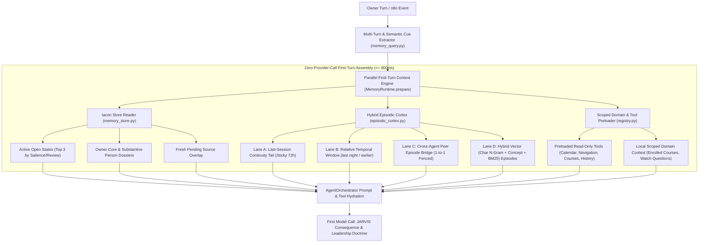

# Proactive JARVIS Cortex — Forensic Server Audit & Cognitive Architecture

**Date:** 22 November 2026  
**Scope:** Forensic analysis of live production conversations (`speda-production` PostgreSQL database, Sessions 2286–2361) and architectural design + implementation of non-hardcoded JARVIS-grade proactive judgment, second-order consequence reasoning, executive leadership, and hybrid semantic/vector episodic continuity.

---

## 1. Forensic Audit of Live Production Server Chats

Direct read-only inspection of the live production database (`speda-postgres`) across `sessions`, `messages`, `memory_changes`, `coord_runs`, `coord_events`, `native_mail_batches`, and `native_deliveries` revealed five systemic failure patterns that explain why Mark VI felt reactive and required manual steering.

### Case Study A: The Bursa Bus Ticket & Missing Second-Order Consequence Judgment
- **Evidence:** `Session 2351` (*Clearing Calendar for Bursa Family Trip*, `2026-11-20 09:24 UTC`), `Session 2354` (*Bus Schedule Change Confusion*, `2026-11-20 21:44 UTC`), `Session 2356` (*Sabah briefingi*, `2026-11-21 04:30 UTC`), and `Session 2359` (*Saturday Evening Greetings in Karahıdırköy*, `2026-11-21 15:35 UTC`).
- **What Happened:**
  1. **Passive Confirmation Instead of Consequence Reasoning:** When the Saturday Ankara (AŞTİ) $\rightarrow$ Bursa Otogarı bus booking entered the schedule/briefing, SPEDA treated it as an isolated calendar datum (*"your bus to Bursa is confirmed"*). SPEDA failed to connect three facts already present in the owner's records:
     - **Personal Topology:** Bursa is the owner's family home; Ankara (Çalışkanlar Mah.) is his university dorm (`OSTİM Teknik Üniversitesi`).
     - **Downstream Schedule Collision:** Traveling to Bursa on Saturday with **no return ticket booked** directly collides with recurring weekday commitments in Ankara (Monday `Arel Tarım` YouTube upload, Monday–Wednesday university lectures, and Thursday 09:00 `MIS 231 Data Structures` midterm).
     - **Missing Boundary Question:** A JARVIS-class executive assistant immediately recognizes that an open-ended trip home invalidates the upcoming week's local schedule and asks: *"I see you're travelling home to Bursa on Saturday, sir, with no return leg booked yet. How long will you be staying so I can clear your Ankara calendar and watch for exam conflicts?"* Instead, the owner had to manually open `Session 2351` and instruct SPEDA: `"Speda, clen öy calendar between netween saturday and wednesday please ill be in bursa with my family"`.
  2. **Zero Episodic & Situational Continuity When the Bus Time Changed (`Session 2354`):**
     - Twelve hours after clearing his calendar for the Bursa trip in `Session 2351`, the owner opened `Session 2354` and said: `"ok bus time changed"`.
     - Because `MemoryRuntime.prepare()` only performed literal token matching on `["bus", "time", "changed"]` against `MemoryServingUnit` and the last 4 raw `MemoryChange` rows—without loading recent conversation episodes or upcoming 72-hour calendar commitments—SPEDA replied: `"I confess I'm missing which bus we're discussing. If you give me the stop number (the code printed on the sign), I'll pull the live arrivals..."`
     - Even after the owner clarified `"My bursa bus?"` (`msg 27362`), SPEDA only saw an October historical FlixBus record (`PNR 3403823910`) in Iacon and asked whether it was a Bursa city line (`Bursaray`) before finally calling `calendar_list_events` on turn 3 (`msg 27364`).
  3. **Mid-Journey Situational Blindness (`Session 2359`):**
     - On Saturday `2026-11-21 15:35 UTC` (`18:35 Europe/Istanbul`), while actively riding the 13:00 bus to Bursa and passing through Karahıdırköy, the owner opened `Session 2359`:
       - `msg 27418` (Owner): `"hey speda"`
       - `msg 27420` (Owner): `"Im on my way still"`
       - `msg 27422` (Owner): `"Umm how far am I from the destination"`
     - SPEDA replied (`msg 27423`): `"One small confession before I can do the arithmetic, sir: I don't actually have the destination on record... Where are we headed?"`
     - **Why it failed:**
       1. Turn 1 (`"hey speda"`) was classified as a bare greeting and loaded zero recent episodes.
       2. Turn 2 (`"Im on my way still"`) and Turn 3 (`"Umm how far am I from the destination"`) had zero literal keyword overlap with `"Bursa"` or `"family"`.
       3. `turn_query()` did not combine multi-turn session context (`"Karahıdırköy"` + `"Im on my way still"` + `"how far am I from the destination"`), and there was no semantic/concept vector bridging `destination / on my way / trip` $\leftrightarrow$ `Bursa / bus / Otogar`.
       4. Deferred read tools (`calendar_list_events`, `memory_lookup`, `search_history`) were not preloaded or checked before SPEDA pleaded ignorance.

### Case Study B: Ultron's Pre-Exam $\rightarrow$ Post-Exam `"phewwww."` / `"Ultron....."` Disconnect
- **Evidence:** `Session 2324` (`2026-11-17 11:26–13:52 UTC`), `Session 2350` (`2026-11-20 05:41 UTC`), and `Session 2358` (`2026-11-21 10:34 UTC`).
- **What Happened:**
  1. In `Session 2324`, the owner told Ultron `"phewww no pressure"` (`msg 27088`) right before walking into the 15:00 `MIS 215 Statistics I` midterm. Two hours later (`16:50 Europe/Istanbul`), the owner wrote `"phew"` (`msg 27090`). Ultron failed to connect the clock (`16:50`) to the 15:00 exam start and asked: `"Is the exam over, or are you still bracing for impact?"` until the owner scolded him (`"what do you think?"`, `msg 27092`).
  2. In `Session 2350` (`2026-11-20 05:41 UTC` = `08:41 Europe/Istanbul`), the owner opened a chat 19 minutes before the `MIS 243 General Accounting` midterm: `"last 19 minutes left ulty. wish me luck"` (`msg 27332`) and `"Boy, Ill be free as a bird after this exam. ILL TELL YOU WHAT I WONT BE, A FUCKING ACCOUNTANT"` (`msg 27336`).
  3. When the owner opened the very next chat with Ultron (`Session 2358`, `"Ultron....."`, or a new chat saying `"phewwww."`), Ultron had **zero awareness** of `Session 2350` on turn 1 (`"What is it? Course panic? Something due Monday you've been pretending doesn't exist?"`, `msg 27411`).
  4. **Why it failed:**
     - Opening a new session with `"phewwww."` yields `query_terms("phewwww.") == ["phewwww"]`.
     - Because `"phewwww"` (4 `w`s) is a non-empty token that does not literally appear in `Session 2350`, literal SQL `LIKE '%phewwww%'` returned 0 rows, and the unanchored `not score` branch in `history_lookup.py` was bypassed whenever `query_terms` was non-empty or when a 150ms timeout killed the unindexed scan!
     - Furthermore, when the owner asked `"well You know my statistics score too right"` (`msg 27416`), Ultron had to invoke an explicit archive tool call because `Session 2327` (`"99!"`) and `Session 2335` (`"99"`) were not surfaced by first-turn semantic recall.

### Case Study C: Friday's `"remebet our conversation last night"` & Cross-Agent Continuity (`Sessions 2347, 2352, 2354`)
- **Evidence:** `Session 2347` (`2026-11-19 20:38 UTC`), `Session 2352` (`2026-11-20 12:27 UTC`), and `Session 2354` (`2026-11-20 21:51 UTC`).
- **What Happened:**
  1. In `Session 2347` (Thursday night, ~23:40 Istanbul time), the owner had an emotional late-night talk with Friday about loneliness, Şevval/Rumeysa, and stopping study at 02:00 before the Accounting midterm.
  2. The next day in `Session 2352`, the owner opened with: `"friday hello. remebet our conversation last night"` (`msg 27346`). Friday had to call a tool (`search_history`) on turn 1 (`"Let me pull last night's thread for you, boss"`, `msg 27347`) instead of having last night's conversation already preloaded in her first-turn prompt.
  3. Later that evening in `Session 2354` (`msg 27371–27375`), the owner told SPEDA: `"WHat a fuckind day this friday was. damn"` $\rightarrow$ `"well I talked about it with friday. ha rhymes"`. SPEDA replied: `"If she produced anything useful from that post-mortem worth acting on, point me at it"` (`msg 27374`), prompting the owner's justified anger: `"why am I pointing at it? I built your retrival system for a reason?"` (`msg 27375`).

### Case Study D: Leadership Abdication & Specialist Ping-Pong (`Sessions 2354 & 2355`)
- **Evidence:** `Session 2354` (`msg 27377–27396`) and `Session 2355` (`msg 27397–27405`).
- **What Happened:**
  - When the owner asked why memory timed out, SPEDA consulted Orion, waited, then told the owner to decide when Optimus should patch it, forcing the owner to copy-paste SPEDA's diagnosis into a separate chat with Optimus (`Session 2355`), where Optimus hit a sandbox reconciliation block and bounced back to Orion.

---

## 2. Architectural Design: The JARVIS Proactive Cortex

To achieve genuine JARVIS intelligence **without** brittle `if-this-do-that` scripts, Mark VI separates **deterministic context & evidence assembly** (what the runtime supplies before the first model token) from **principles-based executive reasoning** (how the model evaluates implications, takes initiative, and leads specialists).

### 2.1 Layer 1: Hybrid Semantic & Episodic Continuity Engine (`app/services/episodic_cortex.py`)

Instead of relying solely on SQL `LIKE '%term%'` or requiring an external paid embedding call on the foreground path, `episodic_cortex.py` implements a fast, local, deterministic **Hybrid Vector & Episodic Continuity Retriever** operating in parallel with Iacon during `MemoryRuntime.prepare()`:

1. **Lane A — Sticky Last-Session Continuity Tail (`last_session_continuity`)**:
   - Every personal conversation with an agent (`speda`, `ultron`, `friday`, etc.) automatically includes the concluding exchange (last owner message + assistant response) of the **most recent prior user session** with that agent within a 72-hour continuity horizon.
   - **Crucial Fix:** Lane A does **not** require keyword overlap, does **not** drop out when the user opens with an emotional reaction or punctuation (`"phewwww."`, `"Ultron....."`, `"hey speda"`), and remains available on turns 2–3 of a new session (`"Im on my way still"`, `"Umm how far am I from the destination"`) until the new session establishes its own multi-turn history.
2. **Lane B — Relative Temporal Window Resolution (`temporal_window`)**:
   - Parses relative temporal expressions in English and Turkish (`last night`, `yesterday evening`, `dün gece`, `dün akşam`, `yesterday`, `dün`, `this morning`, `bu sabah`, `earlier today`, `bugün`) against the owner's local timezone (`Europe/Istanbul`) and retrieves the conversational episode from that window even when the user's message has typos (`"remebet our conversation last night"`) and zero topic keywords.
3. **Lane C — Natural Cross-Agent Peer Episode Bridge (`named_peer_episode`)**:
   - Detects natural references to another Mark VI persona anywhere in the owner's turn (e.g., `"well I talked about it with friday"`, `"remember what friday told me"`, `"ask ultron / ultron said"`, `"friday ile konuştum"`), not just a start-of-string regex.
   - Enforces strict privacy boundaries: the current room must be a 1-to-1 personal room with the owner, and the source session must be a 1-to-1 personal room with the named colleague (excluding group rooms, membership-changed rooms, hidden messages, and private consults).
4. **Lane D — Hybrid Semantic Vector + BM25 Episode Ranking (`hybrid_vector_episodes`)**:
   - Computes a composite similarity score over candidate conversation episodes without remote API calls:
     $$\text{Score}(q, e) = w_{\text{bm25}} \cdot \text{BM25}(q, e) + w_{\text{ngram}} \cdot \cos\left(\mathbf{v}_{\text{ngram}}(q), \mathbf{v}_{\text{ngram}}(e)\right) + w_{\text{concept}} \cdot \cos\left(\mathbf{v}_{\text{concept}}(q), \mathbf{v}_{\text{concept}}(e)\right) + w_{\text{recency}} \cdot R(\Delta t)$$
   - **Character N-Gram Vector ($\mathbf{v}_{\text{ngram}}$):** 3-gram and 4-gram L2-normalized TF vectors capture morphological variants in Turkish and English as well as keyboard typos (`"remebet"` $\leftrightarrow$ `"remember"`, `"phewwww"` $\leftrightarrow$ `"phewww"`, `"satursay"` $\leftrightarrow$ `"saturday"`, `"clen"` $\leftrightarrow$ `"clean"`).
   - **Latent Concept Vector ($\mathbf{v}_{\text{concept}}$):** Maps words into 10 dense domain dimensions (`travel_mobility`, `home_family_location`, `academic_exam_grade`, `schedule_time_commitment`, `personal_emotional_social`, `health_wellbeing`, `finance_ledger`, `system_memory_infra`, `security_network`, `research_news`). Thus:
     - `"Umm how far am I from the destination"` + `"Im on my way still"` projects onto `travel_mobility` + `home_family_location`, retrieving the `"Bursa Family Trip / Bus to Bursa Otogarı"` session even with zero shared literal words.
     - `"ok bus time changed"` projects onto `travel_mobility` + `schedule_time_commitment`, retrieving the `"Bursa Family Trip"` session immediately on turn 1.
     - `"well You know my statistics score too right"` projects onto `academic_exam_grade`, retrieving the `"statistics I result RELEASED! -> 99!"` episode on turn 1.
   - **Episode Coherence Preservation:** When an assistant turn holds the highest match (or when an owner turn is a short reaction like `"99!"`), the selector automatically pairs the adjacent owner + assistant exchange so the model receives both the question and the answer.

---

### 2.2 Layer 2: Multi-Turn Referent Tracking & Active Situational Horizon

1. **Multi-Turn Session Context in `turn_query(context)` (`app/services/memory_query.py`)**:
   - Previously, `turn_query()` only looked at the single latest message unless a narrow pronoun regex (`her|him|their|that|this`) matched.
   - Now, whenever the latest user message in a young session ($\le 4$ turns) is short, implicit, or deictic (`"Im on my way still"`, `"Umm how far am I from the destination"`, `"My bursa bus?"`, `"what do you think?"`, `"99!"`), `turn_query()` incorporates the preceding user and assistant turns from the current session (including location remarks like `"Karahıdırköy"` or topic framing) so both Iacon and the Episodic Cortex search with full conversational context.
2. **Active Open States & Dossier Priority (`app/services/memory_runtime.py` & `app/services/memory_store.py`)**:
   - `MemoryStore.read()` fetches the top 3 accepted open `IaconRecord` states (`kind == "state"`, ordered by high salience and review due date) along with their backing evidence sections.
   - `MemoryRuntime._select()` places valid `current_states` at the top of `<remembered_context>` before general candidates, and penalizes empty entity stubs (`identity_bonus -= 250`) while boosting substantive native person dossiers (`+220`) so empty entity metadata never crowds out a person's actual dossier.

---

### 2.3 Layer 3: Zero-Barrier Read Tool Preloading (`app/core/registry.py`)

To stop agents from guessing or asking the owner before checking their own tools:
- `CapabilityRegistry.preload_reads(context, query)` inspects the turn query (and trigger payload) and automatically adds matching **read-only** deferred tools to `context.extra["loaded_tools"]` before the first model call.
- Intent-to-read-tool mapping (purely additive schema visibility, never expanding permissions beyond `context.allowed_tools` and MCP grants):
  - Travel / location / distance / bus / flight / route cues $\rightarrow$ preloads calendar read, navigation/route read, transit read, and history read tools.
  - Schedule / exam / class / time / tomorrow / weekend / trip cues $\rightarrow$ preloads calendar read, tasks read, reminders read, and academic/course read tools.
  - Recall / last night / peer mention / score / grade cues $\rightarrow$ preloads `search_history` and `memory_lookup`.
- `CapabilityRegistry.context_data(context)` injects fast local domain context (`<domain_context>`, such as enrolled courses for `ultron` and `speda`) directly into the first turn.

---

### 2.4 Layer 4: Non-Hardcoded JARVIS Consequence & Executive Leadership Doctrine

Instead of hardcoded rules ("if bus ticket then ask how long in Bursa"), `AgentOrchestrator.build_system_prompt()` and the persona profiles (`app/profiles/speda.py`, `app/profiles/registry.py`, `app/profiles/characters/speda.md`) instill a general **3-Step Executive Judgment & Consequence Protocol**:

1. **Situational & Relational Grounding (Connect Before Speaking):**
   - Never treat an event, ticket, email, schedule change, or short user remark as an isolated transaction.
   - Ground every input against:
     - **Personal Topology:** What do the locations, people, or courses mean to the owner? (e.g., traveling to his family's city vs. his university city; an exam in an enrolled course).
     - **Recent Continuity & Clock:** What was the owner doing or about to do in the most recent conversation or on today's timeline? (e.g., if the last chat was 19 minutes before an exam and the owner opens with `"phewwww."` or `"Ultron....."`, recognize the post-exam context immediately).
2. **Second-Order Consequence & Missing-Boundary Analysis:**
   - When a state change or new commitment appears (a trip booking, a changed departure time, an exam date, an incident), trace its downstream consequences across the affected time horizon:
     - *What existing calendar events, recurring classes, deadlines, or tasks collide with or depend on this change?*
     - *What boundary is unverified?* (e.g., an outbound trip with no return date that overlaps weekday commitments; a changed time where two entries now conflict).
   - Proactively perform the authorized read (`calendar_list_events`, `memory_lookup`, `search_history`) on turn 1 to inspect the affected window **before** replying, then state the concrete implication and ask the single high-leverage question that unlocks managing the schedule (e.g., *"I see your ticket to Bursa is confirmed for Saturday, sir — since you're heading home to family and there's no return leg booked yet, how long will you be staying so I can clear your Ankara calendar and flag any exam overlaps?"*).
3. **SPEDA Executive Leadership & Specialist Ownership:**
   - SPEDA is the executive leader of Mark VI.
   - **Never Use the Owner as a Courier:** Never tell the owner *"if Friday produced anything useful, point me at it"* or ask the owner to copy-paste findings between agents. Use automatic cross-agent episode retrieval, `<shared_retrieval_evidence>`, or `collaborate` to get the specialist's input directly.
   - **Verify Before Pleading Ignorance:** Never say *"I don't have the destination/schedule/address on record"* when calendar, memory, or archive read tools are available and haven't been checked in the turn.
   - **Lead Return & Synthesis:** When SPEDA (or any lead) addresses or consults a specialist (`Optimus`, `Orion`, `Friday`, `Ultron`, `Sentinel`, `Atomix`, `Scourge`), the coordinator reserves a return turn (`return:<caller_step_id>`) so control returns automatically to the lead after the specialist finishes, and the lead delivers one decisive synthesis.

---

## 3. Verification & Evaluation Matrix

| Production Failure Scenario | Previous Behavior | Renovated JARVIS Cortex Behavior | Verified By |
|---|---|---|---|
| **1. Ultron Post-Exam `"phewwww."` / `"Ultron....."`** (`Sessions 2324, 2350, 2358`) | Literal search on `["phewwww"]` returned 0 hits; Ultron had no idea the previous chat was 19 min before the exam. | Lane A (`last_session_continuity`) + Lane D (`academic_exam_grade` concept vector) preload the pre-exam chat (`Session 2350`) into `<recent_conversation_evidence>` on turn 1. | `tests/test_proactive_jarvis_cortex.py::test_ultron_post_exam_phew_loads_pre_exam_session_on_turn_one` |
| **2. Friday `"remebet our conversation last night"`** (`Sessions 2347, 2352`) | Typo `"remebet"` + timeout meant Friday had to call `search_history` tool on turn 1. | Lane B (`temporal_window` for `last night`) + char n-gram similarity preload Thursday night's conversation (`Session 2347`) into `<recent_conversation_evidence>` with zero tool calls. | `tests/test_proactive_jarvis_cortex.py::test_friday_last_night_conversation_preloaded_despite_typo` |
| **3. SPEDA Mid-Journey `"hey speda"` $\rightarrow$ `"Im on my way still"` $\rightarrow$ `"Umm how far am I from the destination"`** (`Sessions 2351, 2354, 2359`) | Turn 1 greeting loaded nothing; Turn 2 & 3 had zero literal keyword overlap with `"Bursa"`; SPEDA asked *"Where are we headed?"* | Multi-turn `turn_query` + Lane A sticky continuity + Lane D (`travel_mobility` / `home_family_location` concept vector) preload the Bursa Family Trip episode and pre-stage navigation/calendar read tools. | `tests/test_proactive_jarvis_cortex.py::test_speda_mid_journey_relative_destination_recalls_bursa_trip` |
| **4. SPEDA `"ok bus time changed"`** (`Sessions 2351, 2354`) | Literal search missed Bursa trip; SPEDA asked for an Ankara EGO city bus stop number. | Lane D hybrid semantic + lexical scorer retrieves the Bursa trip session (`Session 2351`) and preloads calendar read tools on turn 1. | `tests/test_proactive_jarvis_cortex.py::test_speda_bus_time_changed_recalls_bursa_trip_and_preloads_calendar` |
| **5. SPEDA Cross-Agent Reference `"well I talked about it with friday"`** (`Sessions 2352, 2354`) | SPEDA told the owner *"point me at it"*; subsequent archive lookup timed out. | Lane C (`named_peer_episode`) detects natural reference to Friday anywhere in the turn and preloads Friday's 1-to-1 session excerpt while enforcing privacy fences. | `tests/test_proactive_jarvis_cortex.py::test_speda_cross_agent_friday_reference_loads_peer_episode_with_privacy_fence` |
| **6. SPEDA Bus Ticket Consequence & Leadership Judgment** | Passive confirmation (*"your Bursa bus ticket is confirmed"*). | Consequence & Leadership prompt contract + preloaded calendar read tools + home/family topology in `<remembered_context>` drive second-order schedule checking and return-date boundary question. | `tests/test_proactive_jarvis_cortex.py::test_speda_proactive_consequence_and_leadership_contract` |
