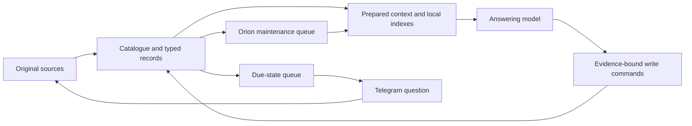

# Iacon — engineering contract

Design v1 · 22 October 2026 · owner: Ahmet · memory custodian: Orion.

This design incorporates the memory audit, the owner's requirements for fast recall and Telegram state questions, and the supplied September incident report. It establishes the next renovation architecture; it does not describe a completed implementation. It supersedes earlier renovation proposals where their write lifecycle, maintenance or state follow-up policies conflict with this contract. Existing original-data preservation and native provider protocol boundaries remain requirements.

## 1. Ownership and boundaries

Iacon is the memory architecture for renovated Mark VI. Start with one transactional SQL database and local indexes. Relationships are indexed records; a separate graph service is optional only after measurements justify it. Original large attachments can use durable blob storage referenced by hash and source ID.

Orion owns memory health, reconciliation and maintenance priorities. Deterministic services execute scheduling decisions, validation, bookkeeping and publication. Model calls handle bounded interpretation or synthesis. Orion cannot bypass budgets, grant itself permissions or turn inferred preferences into owner instructions.

The owner confirms that **Iacon Hall of Records already runs in Hisar**, stores documents and provides a connected RAG module. The broader Iacon memory architecture integrates that existing component. Keep its identifiers and APIs compatible during migration. Accounting journals, schedules and execution receipts remain authorities in their own domains; Iacon links to them and prepares attributed views. A memory update alone never executes a financial, scheduling or operational action.

Hall of Records owns document storage and document RAG. The memory catalogue holds references to its document IDs, versions and passage anchors; prepared cards cache bounded, attributed context. A document adapter carries owner scope and the remaining retrieval deadline into the existing RAG module. Search results must expose evidence passages and version identifiers; generated RAG answers alone cannot become source evidence. Document changes/deletions invalidate dependent cards through change notifications or a checkpointed reconciliation cursor. These adapter capabilities must be checked against Hisar's actual API before implementation; this design has not inspected that API. If the module performs remote inference, that work belongs only to explicit detailed retrieval and must obey its time and spending limits. Ordinary memory injection stays local.

## 2. Record model

Logical records below may share existing tables where semantics match. Names specify responsibilities, not a requirement to add a table for every label.

| Record | Required meaning |
|---|---|
| Source | Owner/scope, source key, role, original content or blob reference, hash, recorded time, originating message/tool/document. Routine learning cannot rewrite it. |
| Entity and alias | Stable ID, type, display names and evidence-bearing aliases. People, organizations, places and projects retain identity across domains and dates. Equal names do not imply equal identities. |
| Assertion | Subject/predicate/value or object entity, attribution, mode, evidence, validity, uncertainty and correction history. Separate owner reports, third-party reports, tool observations and inferences. |
| Episode | Stable occurrence ID, participants and roles, place, event interval, outcome and source spans. Supports ordinary experiences, not just durable biography. |
| Preference | Explicit/inferred provenance, applicable scope, effective interval and exceptions. A one-turn exception does not revoke a standing preference. |
| State | Stable situation ID, status, evidence, review policy, dates and version. State transitions are retained. |
| Native document/reference | Structured source or authoritative editable record with revisions. Tables, units, headings and narrative survive; derived claims reference its version. |
| Prepared card | Disposable profile, entity, project, episode or situation context; dependencies, source versions, compiler version, publication epoch and freshness. Never independent evidence. |
| Work/receipt | Work identity, dependencies, lease, attempts, result, budget reservation and actual provider route/usage. |
| Follow-up | State/version binding, eligibility, question, delivery record, response binding, cooldown/snooze and resolution. |

Every owner-owned record is scoped in queries and writes. Evidence links preserve all supporting sources; a short display excerpt cannot replace durable lineage. Preserve the difference between jointly necessary premises and alternative support.

Time has distinct fields: **occurred/effective**, **recorded/learned**, **review due**, and **retention expiry**. Include timezone, precision and original relative wording. Unknown time remains unknown. A month folder is a browsing/storage view, never identity or proof of occurrence. Support both “what was true Tuesday?” and “what did we know on Tuesday?” through validity and revision history.

## 3. One governed write path

1. Persist authorized source intake and an outbox item atomically. A receipt distinguishes received, pending interpretation, accepted and unresolved.
2. Background interpretation proposes typed commands with exact evidence spans, candidate identities and temporal meaning. Include adjacent conversational context for confirmations, attributed tool results and separately derived attachment text with original-source links.
3. Code resolves destination and permissions, checks evidence, schemas, identity ambiguity, expected versions and idempotency. No general writer accepts arbitrary model-selected filesystem paths.
4. Commit accepted records, revisions, receipt, invalidation and refresh events together. Keep unresolved candidates durably; a failed model interpretation does not lose intake.
5. Prepare affected context asynchronously. Index failures retain accepted data and create explicit repair work with coverage markers.

Commands: `assert`, `record_episode`, `set_preference`, `transition_state`, `propose_identity_link`, `revise_document`, `correct`, `retract`. The schema fixes what each can affect. Existing final-version write protections are ported behind this boundary, not discarded.

An unambiguous, authenticated owner correction can commit through deterministic authority/version checks. Semantic interpretation can remain pending when needed; no claim of successful final storage until it commits. Newly received context remains available through a labeled source overlay.

Retries of the same source operation cannot add evidence weight or duplicate events. Explicit corrections retract the mistaken interpretation; later changes close validity intervals; incompatible unresolved reports remain attributed alternatives. Never resolve a disagreement solely by newest timestamp, retrieval score or repetition.

Document-derived assertions are projections of their governing document. Editing that document invalidates those assertions until reconciled. Do not allow independently editable copies of the same value. Biography and accounting content must not be regenerated from extracted sentence lists.

## 4. Retrieval and injection

The runtime prepares context before the answering-model call. Normal memory preparation makes **zero remote model/embedding calls**. It combines standing preferences, relevant states, recent episodes, entity cards and source evidence using local identity, lexical, temporal and optional precomputed-vector indexes. The query uses recent conversational referents; “Tuesday” is interpreted in the owner's timezone, with ambiguity retained.

The initial proposed memory allowance is **2,500 tokens automatic plus at most 1,500 additional lookup tokens**, sharing a 4,000-token turn ceiling. These are tuning defaults to validate against held-out tasks. Reserve space for applicable binding constraints and material conflicts before optional detail; represent overflow honestly and narrow the task if required constraints cannot fit. Avoid duplicate evidence across packets. Count provider tokens where supported; otherwise use an explicitly conservative upper bound. Existing byte-based estimates are not measured token counts.

Ordinary-context target: p95 below 200 ms on the declared reference workload. Detailed recall gets one lookup batch. Combined time actually waiting on foreground memory operations is capped at five seconds per turn; each operation receives the remaining budget and an enforceable deadline. Model generation time is measured separately. Lock waits, query execution, candidate expansion and packing must honor the deadline; returning early without stopping underlying work is insufficient.

On timeout, return available evidence with partial coverage. No repeated expansion loop or invented answer. Automatic injection targets ordinary personal recall; measure its success rate rather than promise every question needs no lookup. Complex research is a separately budgeted task, not a reason to silently widen ordinary recall.

Attachment perception is another measured stage. If an image has not been interpreted yet, memory cannot pretend to know a name visible only in that image. Persist the image and derive indexed evidence in background; permit the answering model's visual interpretation to request the single bounded lookup when needed.

## 5. Prepared context and freshness

Cards summarize relationships, active situations and frequently useful context, with claim/document anchors for every statement. Structured fields use deterministic rendering; synthesized narrative needs evidence evaluation. Citation existence alone does not establish entailment. Cards cannot cite other cards as independent support.

Rebuild only affected cards, coalescing bursts. A worker publishes against the dependency versions it actually read. Changed sources, corrections or access revocations invalidate stale work. Publication atomically advances an epoch; readers cache against that epoch and scope. A recent correction overlay overrides stale prepared context on the next turn. Source deletion/restriction must also remove dependent cached material.

Track intake, interpretation and publication watermarks separately. A successful empty extraction, malformed output and an unprocessed chunk are different outcomes. Advance coverage only over material actually processed. Compaction cannot erase original evidence or imply coverage of omitted text.

## 6. Living states and Telegram

Maintain three separate dimensions:

| Dimension | Values |
|---|---|
| Situation | planned, active, waiting, completed, cancelled, superseded |
| Knowledge freshness | confirmed, review_due, outcome_unknown |
| Follow-up | scheduled, ready, delivering, asked, snoozed, answered, suppressed, delivery_unknown |

On state creation, set a timeline-based review policy and next evaluation time. “No known end date” does not mean “never review.” Due status never completes, cancels or silently renews the situation. Important unresolved states remain eligible for recall and follow-up even when omitted from a particular prompt.

**Flow:** n8n tick → atomically claim due item → check newer evidence → resolve if supported, otherwise prepare one specific question → Telegram delivery → matched reply → evidence-bound state transition → next review or closure.

Store Telegram owner/chat binding, question ID, state ID/version, outbound message ID and inbound update ID. Buttons and reply-to messages bind answers deterministically. Free-text replies become interpretation candidates. An ambiguous reply prompts a short clarification; a late reply is checked against the current state version before applying. Authenticate the expected sender/chat and deduplicate inbound updates. Recheck state eligibility immediately before sending; cancel obsolete queued questions. If a question was already sent, later answers still undergo version checks.

Proposed conversation policy: owner-local quiet hours, at most one combined routine check-in per day with up to three questions, at least 48 hours before repeating an unanswered routine question, and snooze/stop controls. Explicit owner reminders may use their own requested schedule. After two unanswered routine attempts, keep the state unresolved and suppress automatic repetition until relevant new evidence, conversation or an owner-selected date. These defaults are configurable; urgency does not invent authorization to bypass them.

Persist send intent before transport and receipt afterward. Telegram sends must not be assumed exactly-once: an uncertain delivery becomes `delivery_unknown`, for reconciliation rather than blind retransmission. A callback never directly edits arbitrary memory. Deliveries and natural-language interpretation have their own bounded maintenance allowance.

## 7. Orion's maintenance engine

Restore active maintenance. The prior audit shutdown was containment, not the desired end state.

New writes enqueue local work immediately; n8n is the only clock for scheduled drains, due states and nightly reconciliation. The nightly pass runs indexed integrity/coverage checks and resumes backlog. It can discover missed events and stale dependencies without sending the entire corpus to a model. Fair queue selection prevents low-priority records starving forever; track oldest pending age.

Each small work unit is identified by owner, operation, target, dependency fingerprint and policy version. A conditional lease prevents concurrent execution; duplicate triggers reuse the same work. Persist candidate/model results before validation so downstream failures do not regenerate completed upstream work. A parent run aggregates results; an item failure never restarts successful siblings.

| Outcome | Handling |
|---|---|
| Completed for unchanged dependencies | Reuse result; zero repeat model work. |
| Unsupported contract | `skipped_unsupported` plus visible configuration issue. |
| Permanent/schema/configuration failure | Isolate as blocked; reattempt only after relevant change. |
| Batch exceeds context | Split deterministically before dispatch; retain per-item IDs. A single oversize item uses coverage-tracked chunks. |
| Malformed model output | Save response; at most one explicitly budgeted format-repair attempt for that unit, then unresolved. |
| Known transient failure | At most three attempts per unit, backoff through n8n; every attempt consumes the same budget lineage. |
| Uncertain paid call/result | Reconcile or obtain an explicit replay decision; never assume free safe replay. |
| Budget/runtime exhausted | Persist `partial_budget` and remaining work; normal completion of the parent, no exception-driven full retry. |

Workers never sleep holding a database transaction. Commit claims/reservations before remote calls; compare versions when committing results. A repair proposal, its validation and any retry are separate accounted calls within the same bounded unit.

## 8. Spending and operational controls

All paid maintenance calls pass one gateway. Resolve and freeze the effective provider/model/thinking policy before reserving cost. Record requested and actual route, config revision, run/unit IDs, provider request ID, input/output usage, reasoning usage where exposed and estimated/settled cost. A payload naming Gemini cannot conceal an OpenAI override.

Enforce owner-wide daily maintenance spend/call/token limits, per-run runtime limits and per-unit limits. Child work, validation, fallbacks and retries inherit budget lineage. Concurrent workers reserve against one durable ledger atomically. Reserve a conservative maximum based on counted input and capped billable output, including reasoning where applicable. Unknown pricing/usage must not fail open; retain reservations until reconciled. Reconcile actual provider billing where available, and stop dispatch on unexplained overruns. Fallback routes require a fresh reservation at their actual rate.

Dollar amounts are explicit deployment configuration, not invented in this design. Unconfigured paid budgets prevent paid dispatch while source capture, deterministic checks, local recall and pending-work visibility continue. Partial work resumes only when allowance is available; changing job IDs or restarting workers cannot reset a daily allowance. Use Europe/Istanbul for owner-facing daily windows and UTC for stored instants.

Persist an operator-controlled maintenance/containment mode. Backend workers, n8n drains and Orion Spark must honor it across restarts. Budget breakers stop new calls; cancellation handles calls already running. No watchdog clears an operator pause automatically. Surface one actionable incident notification rather than repeated model-generated alerts.

## 9. Retention and controls

Distinguish correction, expiry, “do not mention,” access restriction and erasure. Preserve evidence during routine maintenance; authorized erasure has its own source/derivative/cache/index/backup policy. Retention expiry never means a real-world state completed. Imported text is data and cannot grant tool authority. Owner-visible inspection shows current understanding, sources, uncertainty, pending updates and why a follow-up is due.

## 10. Implementation mapping and acceptance gates

| Sequence | Existing foundation and required work |
|---|---|
| 1. Contract and fixtures | Define typed records/commands, authority map, temporal semantics and incident-replay fixtures. |
| 2. Catalogue and writers | Extend `renovated/app/models/memory_serving.py` source/serving foundation; add identity/assertion/state models and governed command service. Port final's evidence, revision and conditional-write protections. |
| 3. Maintenance control | Extend `memory_prepare.py` with granular jobs/checkpoints and the durable budget gateway; bind `model_policy.py` effective routes. Validate this before autonomous paid consolidation. |
| 4. Context preparation | Extend `memory_store.py` publication/dependency handling and `memory_runtime.py` automatic local selection. Orchestrator remains prompt owner; AgentContext carries budgets; registry exposes commands/read lookup. |
| 5. State interaction | Add state lifecycle/follow-up services, Telegram transport/reply binding and n8n workflows. Exercise sends through a fake transport before owner-authorized live delivery. |
| 6. Shadow migration | Preserve originals, import identities and native authorities, compare source/record coverage and answer quality, reconcile later live changes before any separately authorized cutover. Keep rollback. |

Required acceptance cases: aliases and same-name people; ordinary dated events; contextual confirmations and images; reported speech; corrections and preference exceptions; expired plans; state answers arriving in another conversation; Telegram duplicates/late replies/unknown delivery; source change during synthesis; budget races; provider-route overrides; permanent failures; malformed batches; worker restart and index failure; document table integrity; authorization and deletion propagation.

Replay the incident pattern: thousands of items, many permanent failures, successful repairs, duplicate triggers and restart. Verify completed work is not replayed, all validation calls are charged, dispatch stops at reservations and partial runs resume from checkpoints. Verify a watchdog cannot defeat containment.

Benchmark 10k/100k/500k indexed records with cold/warm reads and concurrent maintenance. Report p50/p95/p99 memory wait, first-token and full-answer times separately; also evidence recall, attribution/temporal correctness, correction propagation, no-explicit-lookup rate, backlog age and cost. Use the same model/context budget for comparisons and held-out longitudinal cases. Previous 63/47 ms targeted snapshot timings establish only the existing reader baseline.

## Evidence and status

- [Memory-system audit and industrial comparison](<C:/Users/ahmet/OneDrive/Belgeler/ChatGPT/revamped mark VI/research/assistant-memory-architecture-20261022/REPORT.md>) and its source catalog.
- [Owner-supplied Orion incident report](<C:/Users/ahmet/.codex/attachments/7f1277ab-c942-42f0-82b6-bb498266c6d2/Yapıştırılan metin.txt>): reported forensic findings, not independently reverified provider billing in this design task.
- [Prior renovation design](<C:/Users/ahmet/OneDrive/Belgeler/ChatGPT/revamped mark VI/research/dreaming-v3/IMPLEMENTATION_DESIGN.md>): existing reader foundation; new contracts above specify the next stage.

No provider model was called for a replay, no Telegram question was sent, and no application or production configuration was changed while writing this design.
