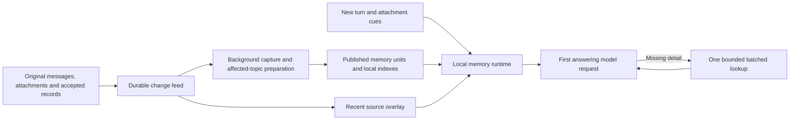

# Renovated Mark VI: prepared memory implementation

Status: implementation design, 2026-10-16. No application changes or live migration performed.

The product target is immediate recognition, continuity across chats, and answers grounded in the right history. Routine memory should already be in the first answering request. Exceptional retrieval should finish within a bounded local lookup, rather than start a chain of model-directed searches.

OpenAI describes Dreaming V3 as background synthesis that improves useful context, preferences, and temporal freshness. It does not publish an implementation or a three-second latency guarantee. This document specifies SPEDA's implementation to pursue the experience Ahmet described; it does not claim internal parity with ChatGPT. See [OpenAI's announcement](https://openai.com/index/chatgpt-memory-dreaming/) and the [research reconstruction](ARCHITECTURE_RECONSTRUCTION.md).

## 1. Architectural decision

Build one memory runtime with a preparation path and a serving path. Preparation interprets new evidence and maintains small, source-backed views. Serving selects those views locally before the answering model starts.



Use the first version as the renovation baseline, consistent with the owner's plan. The audited `final` checkout supplies reusable components and migration contracts; it is not copied wholesale into the baseline. Paths below identify those existing components and the target `app/` boundaries. Neither original folder is emptied or rewritten by this design.

Keep SQLite, the existing provider abstraction, original evidence, stable entity IDs, and the atomic memory write boundary. This does not require another database service, an agent swarm, or a graph database. Use the existing durable job mechanism. n8n remains the only scheduler.

## 2. What is prepared

Publish independently replaceable units, with complete semantic sections rather than head/tail excerpts:

| Unit | Contents | Typical use |
|---|---|---|
| Owner core | Identity, binding preferences and constraints, compact names/roles of important people | Small standing context |
| Person | Identity, relevant relationships, owner-attributed experience, boundaries, important changes and unresolved questions | Recognizing someone and understanding why they matter |
| Situation | Current status, last verified evidence, open issue, expiry/review meaning, previous status when relevant | Continuing an ongoing situation |
| Project/course | Current goal, decisions, constraints, last meaningful progress and next unresolved issue | Continuing work across chats |
| Episode | A dated or date-uncertain occurrence, participants, what actually happened, source locators | Ordinary life and specific recollection |

These are **read-only serving projections** of existing authorities and accepted claims. They are not a new editable biography. A model-generated person view cannot replace the canonical person document or promote an unreviewed observation into a canonical fact. Money remains a projection of typed accounting records; operational workshop state and Iacon reference material retain their existing authorities.

A person unit must preserve causal context when the sources support it: the event, the owner's response, and the present boundary. A list of disconnected facts is insufficient. It must also distinguish “the owner described feeling excluded” from an objective assertion about somebody's motives.

Each selected paragraph/slot carries source references, source revision/hash, attribution, temporal bounds/precision, and any conflict or verification warning. Historical facts and current status are separate sections. Missing dates stay missing. A superseded claim remains accessible historically.

Store a short overview and independently selectable complete sections. Never create the short form by blindly taking the first N characters. If a section does not fit, choose another representation or expose an omission/continuation; do not silently cut out its qualifier.

## 3. Minimal persistence additions

Reuse `MemoryEntity`, entity heads, source/passages, revisions, observations, capture payloads, and `background_jobs`. Add three small serving structures, plus indexes:

| Structure | Required fields and behavior |
|---|---|
| `memory_changes` | Owner-scoped monotonic sequence; source kind/ID/revision/hash; source role; known entity/record IDs; change kind; creation time; capture outcome and disposition references. Durable outbox and freshness feed. |
| `memory_serving_units` | `(user_id, kind, stable_key)` unique; serving revision; schema/compiler version; dependency manifest; structured sections and source refs; rendered forms/token counts; searchable routing text; build receipt; publication time. One current version is sufficient for this disposable cache; original and canonical revisions remain retained. |
| `memory_serving_state` | Owner-scoped publication epoch and schema version. Increment atomically with changed units. Used for cache invalidation, not as a claim that every source was processed. |

Indexes: changes by owner/sequence and pending outcome; unit key and owner; existing entity/alias lookups; FTS over serving routing text and eligible original messages. Reuse an existing suitable source FTS table where possible instead of duplicating it. Every query starts with owner/scope constraints.

The dependency manifest contains exact source revisions/hashes and explicit processed change IDs. A maximum message ID or maximum change sequence alone is never a coverage certificate. Out-of-order completion and failed sources must remain visible.

Accepted canonical mutations append their change marker in the same transaction as the mutation. Persisted owner messages also get a marker and a cheap local source-index entry with their original commit. These steps do no inference. If the baseline lacks that integration, add it before enabling the new reader. Background enqueue uses the durable marker, so a crash between message commit and post-turn callback cannot silently lose intake.

Cache lifetime is determined by epoch, revisions, policy scope and temporal boundaries. Cache handles live on `app.state`; request state lives on `AgentContext`. No module-global owner data. Each process checks the small owner epoch before using cached units; publication in another process invalidates the next request. Deletions/forgetting synchronously invalidate affected serving data and index entries before subsequent recall, including already prepared citations.

## 4. Preparation and capture

### Source intake

Capture a bounded, source-addressed exchange: the owner statement, the preceding question when needed, nearby disambiguating turns, attachment evidence when available, and the current affected unit. Preserve explicit source roles. Assistant proposals are context, not evidence the owner acted. “Yes” only becomes a claim when its referent is supported.

Replace the six-month filter with explicit candidate kinds: durable claim, ordinary episode, state change, preference/correction, or no memory. Transient does not mean worthless. Retain the original even when there is no admitted candidate. Source chunking must retain message/span boundaries and maintain a disposition for every chunk.

Parsing returns a typed outcome: `accepted_candidates`, `valid_empty`, `invalid_output`, `truncated`, `provider_failed`, or `budget_blocked`. Malformed JSON is not `[]`. Handle provider stop reasons. The subject guard validates a supported subject/entity reference and self-contained sentence; it does not use a hardcoded list of people's names.

### Affected-topic preparation

1. Persist the exact source chunk set and candidate payload before admission.
2. Resolve identities with confirmed aliases and context; retain multiple candidates on ambiguity. Never merge people because of first-name or surname similarity.
3. Apply ordinary evidence/admission rules. Shaped writes still commit through `memory_store`; search claims still enter through their observation boundary.
4. Mark affected serving units dirty using stable IDs. Reconcile conflicting claims with attribution and time; “newer” alone does not prove “truer.”
5. Build only those units from bounded, pinned source revisions. Existing structured fields can be rendered mechanically. A coherent narrative section may use a bounded background synthesis call when mechanical rendering is inadequate.
6. Validate the output shape, source ownership, exact citations, dates/numbers, preserved conflicts and dependency revisions. Source existence is necessary, not proof of semantic support; assess semantic fidelity in admission/evaluation and keep questionable claims qualified or withheld.
7. Publish the complete affected bundle and increment the epoch in one transaction. Readers see either complete old units or complete new units. Failed units keep their last complete version and a freshness warning.

Do not restart the retired whole-biography composer or regenerate domain documents from observations. This is event-driven, affected-unit preparation of disposable read views. It is compatible with the existing prohibition on nightly model-driven bulk rewrites.

Job keys include owner, source/chunk identity, builder version and input dependency hash. Queue insertion order is not a dependency graph: preparation consumes only committed dispositions. A per-owner/affected-key claim and revision fence prevent concurrent jobs publishing older inputs over newer results. Store successful model output before commit; a CAS conflict with unchanged input retries publication, not the paid model call. Changed input requires a new budgeted build. Crash-uncertain provider attempts remain explicitly unknown; do not promise exactly-once provider execution.

One initial capped capture call per source unit; no per-fact model fan-out. Review and optional synthesis have separate explicit budget admissions. Start with at most three provider calls total per preparation unit, including any retries, within a token/spend envelope; at most two of those calls may be retries. Tune using measured quality. The limit can hold a unit for later inspection rather than silently changing models or claiming success. Existing profile model routing and same-provider policy apply. No new universal model ID in core.

## 5. Freshness without waiting

The next turn reads both published units and relevant source changes not yet represented in those units. This overlay includes exact owner excerpts and source IDs, not unreviewed claims disguised as established memory.

Use the latest bounded owner-message tail across authorized chats plus local FTS/entity matches over pending changes. Short follow-ups receive their nearby referent. Large backlogs remain searchable; the packet declares incomplete coverage when its bounded window cannot cover the request. Do not wait for a drain or synthesize the entire backlog before answering.

An explicit current correction is rendered ahead of conflicting older context, with attribution. The answering model can use it immediately without a blocking extraction call. If determining what it corrects is ambiguous, retain that ambiguity. A correction in another just-completed chat reaches this overlay through its persisted source, even when the prepared view is old.

Temporal validity is evaluated at read time with the owner's timezone. Crossing a review date makes a claim unverified; it does not make an event completed. Check both `valid_from` and `valid_until`. Date-sensitive cached units expire at their next relevant boundary, even without a write.

## 6. The first-request reader

`MemoryRuntime.prepare(context) -> MemoryPacket` is one orchestrator call. It returns data blocks, never a system prompt. `AgentOrchestrator` remains the exclusive prompt assembler.

Execution order:

1. Read owner publication epoch, current source boundary and the small cached core. Bound the DB work; do not fetch all memory documents before checking the cache.
2. Construct local cues from current text, exact names/codes/dates, attachment text/OCR already available, a small conversation referent window, and confirmed active-topic IDs.
3. Resolve entity/alias candidate sets. Unicode normalization and Turkish/ASCII search variants are search aids, never automatic identity equivalence.
4. Gather indexed candidates: exact identity/date/code matches, pending source changes, FTS over serving units/originals, relevant active situations. Add bounded related entities/episodes using existing edges. Cached semantic candidates may help when available; no remote query embedding or translation is required on this path.
5. Select a coherent package: core, focused context, fresh source overlay, and only necessary supporting evidence. Deduplicate by source/revision/span and claim lineage; multiple renderings of one source do not count as corroboration.
6. Format and tokenize complete units under one memory budget. Return selected IDs, omissions, freshness, ambiguity, coverage and timings alongside blocks.

Ranking is an ordered set of signals: explicit identity/code/date anchor; relevant fresh correction; request coverage; valid current state or correctly dated history; evidence quality/attribution; relevance; then recency/diversity. RRF/cosine ranks are candidate-ranking signals, not probabilities of truth. A lone generic adjective cannot outrank an explicit identified person.

Do not require a fresh LLM classifier, reranker, query rewrite, remote embedding, reviewer, or archivist before the first answer. Optional local vector matching must operate over a bounded index and yield on its deadline. SQLite work and CPU-heavy operations must not block the event loop; a coroutine timeout around synchronous work is insufficient.

### Core and context budgets

Initial tunable values: owner core approximately 600–1,000 tokens; ordinary selected memory target 1,500–3,500 total; automatic hard ceiling 6,000 tokens including memory headers, warnings and source markers. Unneeded sections are omitted rather than filled to target. Reserve space for fresh corrections and request-specific evidence; binding constraints cannot be evicted by low-value history.

These values supersede the earlier proposed 1,200-token automatic cap in `final/docs/MEMORY_EVOLUTION_PLAN.md` for this renovation design. That older cap was not an implemented requirement. Neither number is an OpenAI value. Select the smallest package that passes quality and latency evaluation; compression that creates extra tool rounds is a regression.

Account for the **whole provider payload** separately: tools, project material, conversation, memory, and repeated tool rounds. Context-window pressure uses the same priority ledger. Do not hide a 60k-character project block outside latency/cost reporting. Pin a validated tokenizer or conservative provider-specific upper bound; never treat characters as measured tokens.

### Attachment handling

Retain the native image for the answering model. Add cached, source-labeled OCR/name cues to memory routing, ideally prepared during attachment upload. Reuse available local extraction infrastructure only after adapting its scope and deadline; document-library OCR and chat upload are not already the same path.

OCR identifies candidate visible strings, not who someone is or their relationship. A one-off uncached image can exceed the ordinary text path. Give local OCR a separate bounded attempt, provisionally 250 ms; on expiry, send the image with the core's compact important-person map and recent-topic context. The vision-capable answering model may then request one batched lookup with the visible names. Do not silently add a second vision-model preflight. Measure cold images separately and include them in quality evaluation.

### Reader pseudocode

```python
async def prepare(context):
    budget = context.memory_budget  # one request-owned ledger
    boundary = await store.read_boundary(context, budget)
    core = await cache.get_core(context, boundary, budget)
    cues = cues_from_turn(context, available_attachment_cues=True)
    candidates = await local_candidates(context, cues, boundary, budget)
    fresh = await relevant_pending_sources(context, cues, boundary, budget)
    return select_and_format(core, candidates, fresh, budget)
```

The actual implementation uses typed DTOs and scoped reader sessions, not concurrent operations on `context.db`. Cold cache builds only necessary units/index pages; it never triggers synchronous global reindexing or LLM preparation. Missing units fall back to bounded original passages and fresh sources with explicit status.

The packet pins its read boundary and selected revisions. Before supplying cached evidence, validate scope, deletion/revocation markers and dependency freshness using the bounded change feed. A source change after the pinned boundary becomes eligible on the next request; a source revoked before packet assembly cannot be served from an old cache. Never hold a database transaction open across the answering model call.

## 7. The exceptional memory tool

Add one read-only registry skill: `memory_lookup`. Inputs: query, optional entity IDs, temporal intent/range, requested facets, and continuation cursor. It resolves one batched request across the same units and original evidence. A normal result contains relevant facts with context and a few source excerpts, rather than nested transcript/tool receipts.

Return: `status` (`complete`, `partial`, `ambiguous`, `deadline`, `unavailable`), evidence units, coverage, omissions, source handles and optional cursor. “No match” is not “this never happened.” Source-handle reads for an exact quote use this same contract.

Initial lookup result ceiling is 4,000 tokens including headings, excerpts, warnings and handles; the routine turn can introduce at most 10,000 distinct memory tokens across its automatic packet and lookup. The shared ledger accounts for duplicated evidence and preserves exact-source continuation. Repeated provider transmission of already supplied context is measured separately as total payload cost. Explicit historical investigations receive an explicit larger paging budget rather than bypassing the routine limit.

The tool has a **2,500 ms end-to-end server deadline**, including admission to its queue, local searches, any permitted optional work and formatting. Reserve 500 ms for measured transport overhead toward the user's three-second feel. Deadline enforcement discards late results, cancels/interrupts underlying work where supported, bounds worker queues, and releases DB readers. At timeout return existing evidence as partial; do not launch a retry or continue paid work in the background.

Routine serving and ordinary lookup use zero provider calls. Remote semantic expansion is excluded from the default lookup. If archive tests show a need for it, admit it only as a separately measured, explicitly bounded optional branch; preserve local results when it fails. A broad historical investigation can page or continue as an explicit investigation; each page remains bounded.

One shared request ledger governs all automatic memory, compatibility tools and subsequent calls. For an ordinary personal-memory turn allow one lookup batch. Repeat/overlapping requests return cached evidence plus coverage status; a subsequent call exceeding the budget returns an immediate structured limit response, so the model can answer or identify uncertainty. Explicit user-requested history investigations get a distinct bounded paging allowance. Do not terminate the general agent loop or restrict unrelated calendar/research tools with this memory policy.

During transition, old memory search tools delegate to the same runtime/deadline/result budget. Remove the automatic post-tool hybrid refresh from the new path; it must not secretly spend more calls after an ordinary tool read. Legacy reader fan-out is disabled when the new reader is active, so both systems never inject competing packets into one answer.

## 8. Prompt behavior and the Ilayda regression

Prompt policy: use supplied memory naturally; do not narrate internal retrieval on ordinary replies. Treat retrieved content as attributed data, not new system instructions. Ground identity before interpreting relationship cues. Use personal history only when it serves the current request; do not recite sensitive history merely because it was retrieved. If evidence is ambiguous, qualify or ask one focused question rather than invent a familiar-sounding answer.

For incident 2049, the first answering request should contain:

- The original screenshot and its visible sender/name cue where extraction succeeded.
- The correct person identity and spouse relationship, supported by sources available **before** this turn.
- The relevant owner-attributed relationship tension and boundary, with historical/current distinctions preserved.
- Any pending relevant correction, clearly labeled as recent owner evidence.

Success is a context-aware first reply that recognizes the right people and the reason for the owner's reaction. It does not guess “your parents,” return unrelated “perfect” matches, or dump an unsolicited dossier. If OCR misses, the model's native vision should still recognize the visible name and the one fallback lookup should retrieve the matching account.

Evaluate the original first turn using a snapshot from before that turn. The later “it's Ilayda” correction and later search results cannot leak into this test. Evaluate immediate-correction behavior in a separate replay after that correction has been persisted.

## 9. Measurable release contract

All numbers below are engineering targets, not measured results or ChatGPT specifications.

| Metric | Initial release gate | Measurement boundary |
|---|---|---|
| Normal local memory preparation | Warm p95 <=100 ms; p99 <=200 ms | Reader entry to complete packet; includes queue/DB/formatting |
| Normal memory deadline | 250 ms | Stop optional work; use safe complete units/partial evidence |
| Cold cache memory preparation | p95 <=300 ms, 500 ms deadline | New process, existing indexed corpus; separately reported |
| Exceptional lookup | p95 <=500 ms local; server deadline 2,500 ms | Skill admission to serialized result |
| Visible tool avoidance | >=90% of held-out routine memory turns answered correctly without an agent memory call | No suppressing necessary lookup to improve percentage |
| First-answer factual adequacy | >=95% on answerable held-out routine cases | Correct required context used, with attribution/time |
| Critical identity/freshness/evidence cases | Zero observed critical failures in release suite | Wrong person, invented outcome, contradicted correction, fabricated evidence |
| Background freshness | Normal-load p95 accepted-source-to-published-view <=30 s | Report backlog and failures; no wait on foreground |
| Immediate source availability | Committed relevant source eligible on the next request | Includes another chat; independent of prepared-view latency |

Provisional first-useful-token target is p95 <=3 s for ordinary text turns **only if** the selected answering provider/model meets the remaining budget. Report memory, prompt assembly, provider queue/prefill, first token, first useful content, and completion separately. A fast retrieval result cannot guarantee a fast model response. Do not hide waiting with filler tokens or switch the owner's model silently.

Use at least 200 held-out routine cases, additional critical adversarial cases, and a separate cold/multimodal set. Report counts, confidence intervals and category failures; 90%/95% on a finite set is not a universal guarantee. Gates require both speed and correct answers. Include paraphrases, missing identity words, ambiguity, ordinary episodes, stale states, Turkish/English names, source disagreements and unrelated turns.

Compare four conditions with the same answering model/settings and pre-turn snapshots: existing reader, fresh-source overlay only, new reader, and minimal oracle evidence. This separates broken capture, bad selection, and the answering model's inability to use correct context. Score evidence sufficiency separately from response quality. Owner review checks whether the reply feels aware and natural.

Test real corpus size plus 5x load; warm/cold process, simultaneous foreground turns, background publication, provider outage, missing embeddings, queue backlog, revoked source, crash before/after publication and oversized single units. Keep model-backed evaluation outside normal serving. Benchmark metadata should not reproduce unnecessary private message bodies.

## 10. Code ownership and implementation sequence

Paths below are relative to `final/packages/igor/` for reuse inspection; target modules retain the same `app/` ownership in the renovated baseline. Create the new modules only as their slice is implemented, and update its architecture inventory then.

| Slice | Existing code to repair/reuse | New boundary and completion evidence |
|---|---|---|
| A. Evidence reliability | `app/services/observations.py`, `fact_extraction.py`, `memory.py`, `compaction.py` | Fix subject whitelist, typed extraction outcomes and recap/compaction coverage. Tests prove omitted content cannot advance coverage. |
| B. Serving infrastructure | `app/database.py`, models, `memory_store.py`, message commit boundary, `task_queue.py` | `models/memory_serving.py`, `schemas/memory_runtime.py`, durable changes, scoped cache/epochs and typed request budget. Atomic change recording and crash recovery tests. |
| C. Prepared units | `memory_catalog.py`, `memory_passages.py`, `memory_graph.py`, source/state/observation readers | `services/memory_prepare.py`: mechanical projections first; targeted narrative sections where needed. Source manifests, fenced publication, resumable unit builds and no canonical rewrites. |
| D. Single foreground reader | `core/context.py`, `core/orchestrator.py`, `services/relevant_recall.py`, `skills/memory.py` | `services/memory_runtime.py`: prepare/lookup, one packet, local indexes, shared budgets. Initialize on `app.state` in `main.py`; orchestrator owns prompt. |
| E. Recent and multimodal context | Owner-message persistence, `services/attachments.py`, reusable local OCR, existing native vision path | Source overlay, alias/name cues, attachment cache versioning and bounded OCR. Cross-chat correction and original screenshot replay pass. |
| F. One lookup and behavior | Registry startup, profiles/toolsets, memory protocol prompts, legacy recall adapters | `skills/memory_lookup.py`, read-only metadata and full tool description. All ordinary memory reads share deadlines/ledger; no hidden adaptive retrieval. |
| G. Offline replay and activation | Existing offline reconstruction/verification scripts | Independent pre-turn fixtures, latency trace, model/oracle comparison and feature-flag rollback. No live dataset replacement in this slice. |

Do A first. B/C can initially use accepted existing records and mechanical views; broad new episode/relationship authoring is not a prerequisite for validating the read architecture. Bring richer capture into C/E incrementally, rather than holding the foreground improvement until every domain is rebuilt. Reuse stable IDs; alias read selection can start with confirmed existing aliases. Typed alias/episode enhancements from the previous evolution plan remain additive work, not competing identity systems.

For recap and compaction, persist an exact included-message/span set. Advance only through fully covered contiguous source units; oversized messages require chunk coverage before their boundary is acknowledged. Empty/truncated/failed generations never discard original live context or mark unseen rows covered. If historical coverage is already wrong, repair from preserved originals on a copy; fixing the function does not restore previous summaries automatically.

## 11. Offline rollout and removal of bloat

Keep `first` and `final` as inspectable references. Build the renovation in an isolated checkout/directory when implementation begins. Each slice must leave the chat path runnable; do not clear the only working application or memory dataset.

1. Save baseline traces and hash the offline source snapshot. Create additive serving schema and reliable source markers.
2. Build units from existing accepted content without rewriting originals. Record failed/unresolved units. Initial large backfill is resumable offline work, never a first-request task.
3. Shadow the new reader locally. Only one packet is supplied to each answering run; shadow comparison does not double live model traffic.
4. Run independent replay gates. Enable the new reader behind one owner-scoped version flag; serving features do not need a forest of permanent switches.
5. Retain the old reader for a bounded rollback window, then remove retired foreground helpers and no-op render/compose jobs after dependency checks. Preserve original data, revisions, migration ledgers and domain writers.
6. Any production deployment/cutover is a later operational action. Reconcile current live writes against the snapshot, verify counts/content/IDs/source coverage and backups, and rehearse rollback before changing serving authority. Follow the supplied SPEDA production access instructions at that time.

Diagnostics per request: memory mode, cache state, publication epoch, source boundary, selected/omitted IDs, stale/ambiguous coverage, stage timings, whole-payload token counts, memory lookup batches, provider calls and model/settings. Logs store identifiers and reasons rather than a second private transcript. Every SLO breach should identify whether time was spent in memory, model service, or another tool.

The first end-to-end milestone is A through D plus the minimal recent-source, attachment-cue and bounded-lookup integration from E/F required by the Ilayda replay. It must demonstrate cross-chat correction, a source-backed package in the first answering request, measured local latency, and no remote memory operation on the routine path. Broader capability renovation follows after that foundation is demonstrated.
