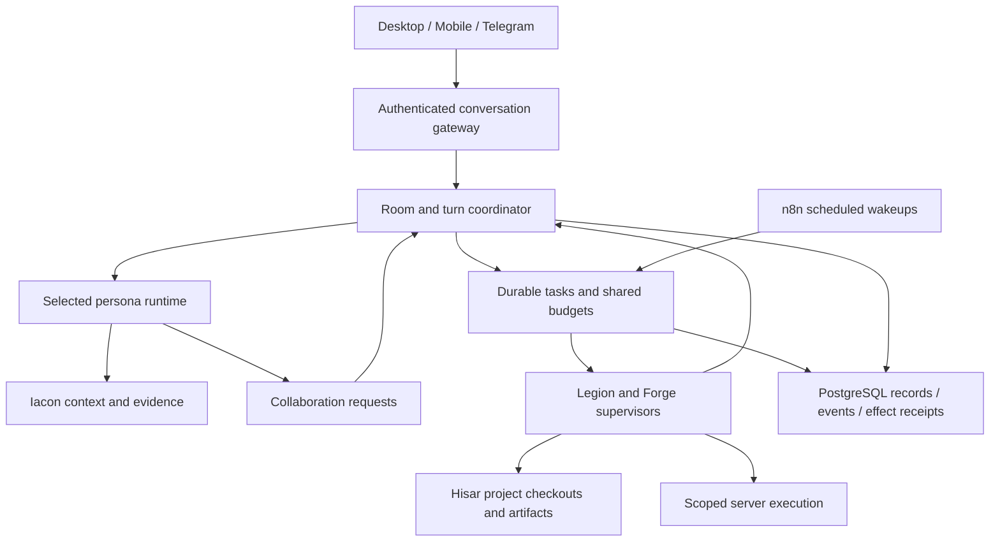

# Mark VI: shared rooms and durable work

Proposed architecture, completed 24 October 2026 after the study begun 23 October. This specifies the next renovation; it is not a claim about deployed behavior. Iacon retains its name and responsibilities. No additional product codename is required.

## 1. Structure and ownership

The coordinator is ordinary code: membership, eligibility, ordering, limits, persistence, and cancellation. SPEDA is the character who normally leads the room and makes judgment calls within those rules. SPEDA can ask a specialist to lead a task without transferring ownership of the whole conversation.

Use one persona runtime for all eight identities. Retain Forge's specialized coding runtime behind an executor interface. They share policy, budget, task, event, and artifact contracts; merging their different tool loops into a giant class is unnecessary.

Start with a modular backend and separately supervised execution processes. PostgreSQL owns coordination records; Hisar owns project files/artifacts; Iacon owns personal knowledge. Caches and live subscriptions are replaceable. No framework is needed merely to give eight characters eight identities. See the [runtime comparison](<C:/Users/ahmet/OneDrive/Belgeler/ChatGPT/revamped mark VI/research/orchestration-20261023/SOURCES.md>).

## 2. Three interaction modes

| Mode | Flow | Completion |
|---|---|---|
| Direct | User → addressed persona → response/tools | That persona answers. No extra planner call. |
| Room | SPEDA or user invites selected personas; coordinator grants turns | Participants speak as themselves. SPEDA resolves the decision or states remaining disagreement when useful. |
| Project | An admitted objective becomes a dependency graph of bounded tasks | Verified acceptance criteria and reconciled effects determine completion. A worker finishing is only one event. |

These modes can coexist: a room stays conversational while its project workers run. A long task must not occupy the chat transport or prevent a status question.

Explicit mentions select speakers without a classifier call. Ordinary messages go to the current conversation lead. That model can request another participant through a small typed collaboration interface as part of its existing turn. Deterministic rules validate the request; a second model does not inspect every message just to decide who speaks.

## 3. Real collaboration in the same chat

Each room stores members, lead, topic, linked project, authorized context scope, and a sequenced event history. Membership allows participation, not unrestricted tools or automatic invocation on every message.

Actions have different meanings:

- `invite`: bring a persona into the room with a purpose and relevant catch-up packet.
- `address`: ask an existing participant to respond to a particular message or finding.
- `consult`: obtain a specialist result for the caller without adding a public room participant.
- `delegate`: create tracked work with an owner, output contract, limits, and acceptance criteria.
- `handoff`: explicitly transfer the conversational lead; the UI records the change.
- `dismiss`: stop future automatic turns from that participant. Existing work remains visible until separately cancelled or reassigned.

The room record preserves each agent's exact delivered words. SPEDA does not rewrite every specialist bubble in JARVIS's voice. Direct replies identify the message they answer. Agents can ask each other questions, challenge an assumption, request evidence, and revise a proposal. They receive the relevant previous contributions before speaking.

For independent investigations, collect initial findings separately before cross-review so the first confident speaker does not anchor everyone. For genuine dependencies, run sequentially. A shared decision record tracks proposal, evidence, objections, owner, and disposition. Agreement without new evidence is not additional verification. Unresolved disagreement remains explicit.

Start with a configurable six-contribution automatic round, including the lead's conclusion, and at most three simultaneous model calls across the task tree. These are proposed engineering defaults, not researched optimal values. An explicit longer discussion can raise them within the owner's spending policy. A new user message starts a new bounded round; agents cannot reset their own counters by creating rooms or children. Repeated identical requests and no-progress exchanges terminate the automatic round.

The client supports invite/dismiss, mentions, reply-to, visible speaker identity, per-speaker streaming, attachments, task cards, and stop controls. Concurrent work may stream in separate cards, but public conversation turns have one ordered speaking slot. Reconnect uses a durable cursor and deduplication. A completed message is authoritative; transient deltas carry message/attempt IDs and may be replaced by its persisted snapshot. Late output from a cancelled attempt cannot masquerade as the current answer.

New user input has priority. During a speaking turn it is queued or explicitly steers/stops that turn according to the selected action. Worker steering has separate queued, delivered-at-boundary, and acted-on evidence; “message accepted” does not mean the agent followed it. Closing the UI is not cancellation. “Stop this reply,” “stop this task,” and “stop the entire project run” target different scopes.

## 4. Character fidelity as an acceptance requirement

| Persona | Required portrayal | Existing operational role |
|---|---|---|
| SPEDA | J.A.R.V.I.S., MCU | Personal assistant and room lead |
| Ultron | Ultron, MCU | Academic life and study |
| Optimus | Optimus Prime, Transformers Prime | Engineering; leads Autobots |
| Friday | F.R.I.D.A.Y., MCU | Inherits Nightcrawler's research/OSINT function |
| Atomix | Atomix, Ben 10 | Health, training and wellbeing |
| Scourge | Scourge, Transformers: Rise of the Beasts | Security; leads Decepticons |
| Sentinel | Reference undecided | Preserve the existing financial identity pending direction |
| Orion | Orion Pax, Transformers Prime | Iacon clerk and system maintenance |

These are specific portrayal targets, not loose themes. A `PersonaSpec` contains stable identity ID, display name, reference/version, character interpretation, priorities of attention, speech rhythm/register, humor, disagreement style, emotional adaptation, relationships, examples, and forbidden drift. Examples should cover ordinary conversation, technical work, errors, success, grief/frustration, and disagreement. Curated original examples are preferable to dumping scripts into every request.

Separate four configurations: **identity**, **domain/tool authority**, **model/thinking policy**, and **presentation preferences**. A humor setting is not a thinking budget. Provider temperature is not a fidelity dial. Permissions do not expand because a character is commanding or menacing.

Keep the recognizable voice during serious work: Ultron's argumentative cadence, Optimus's deliberate authority, Scourge's economical scrutiny, and Orion's earnest curiosity must not all collapse into the same generic report voice. Relationships also differ; they may disagree without becoming interchangeable reviewers. Avoid mandatory catchphrases, greetings, or a common “friendly assistant” paragraph that overrides the character.

The user's specific instructions can change presentation. Within the selected portrayal, profile-specific controls preserve its structure; a temporary request for brevity does not replace the identity. Permanent departures become an explicit profile revision, not accidental drift from accumulated chat. Internal JSON extraction/review jobs use compact operational prompts; Orion's public dialogue gets Orion's character.

Compile the selected identity once, then its role and actual capabilities, scoped context, and current request. Pin profile and policy versions to every run; changes apply at a recorded boundary. Keep a small cached core and a few relevant examples, with a measured token allowance. Do not add a paid personality-polishing call after every answer.

Extend the existing live-dialogue evaluation harness. Test anonymous speaker identification, adherence to the requested portrayal, competence, independent judgment, naturalness, and preservation across long chats, Turkish/English switching, room debates, compaction, failures, and provider changes. Include paired Optimus/Orion and SPEDA/Friday comparisons. The owner's blind review is the acceptance authority; an automated grader only assists. Multi-turn character research supports multidimensional evaluation, but provides no guarantee for this cast. [CharacterEval](https://aclanthology.org/2024.acl-long.638/).

“Exactly like them” is the design target. No prompt or framework proves exact reproduction. The release evidence must be actual dialogue you consider faithful. Audio delivery is a separate optional profile field; text personality acceptance does not establish an actor-identical voice.

## 5. Personas, workers, Autobots and Decepticons

Named personas persist across chats. Worker instances have execution IDs, narrow roles, short-lived contexts, and explicit reports. They do not impersonate another enduring character or create personal memories from their own speculation.

Optimus owns engineering decisions and Autobot milestones. Scourge owns security assessments and Decepticon findings. Both can contribute to the same project; neither silently takes over the other's checkout. Research workers, archivists, and reviewers remain useful roles. A verification worker records what it actually checked and can return partial or inconclusive results.

A task assignment includes objective, parent/root IDs, owning persona, input evidence/artifact references, project and base revision, allowed tools/paths/network, dependencies, deadline, spending slice, expected output, and acceptance checks. Results contain status, findings, evidence, changed artifacts, executed checks, limitations, and next steps. Structured metadata accompanies normal readable prose.

Default worker depth is one. A worker needing more help requests it from its supervisor; any approved child uses the same root budget, deadline, and concurrency pool. Independent reads can run concurrently. Mutations run in dependency order or isolated checkouts. Concurrent workers get separate database sessions and immutable context snapshots.

## 6. Hisar project continuity

Create a stable project ID independent of its path. Preserve mappings to existing path-derived workshop IDs. Bind rooms/chats to the project once. Resolve its current location through `(project_id, host_id, approved_root, location_version)`; never reinterpret a Windows path on Linux or let a global picker silently move an old conversation.

The project record holds objective, acceptance criteria, durable decisions, constraints, milestones, owners, blockers, next action, relevant Iacon/Hall references, and artifact revisions. Each execution checkpoint additionally records Git base/head, worktree, dirty changes, tool receipts, checks and their exact revision, outstanding external effects, and authority/budget remaining. A summary is a navigational aid; file and result references remain inspectable.

On “continue this project”: resolve the binding → read checkpoint and pending work → inspect actual files/Git/Cell state → reconcile differences → execute the next authorized milestone. A changed checkout invalidates old verification where relevant. Resume from the last safe boundary; never reconstruct unknown effects from optimistic prose.

Provision one worktree or isolated snapshot per concurrent writer before launching it. Keep one integration owner and serialize merges. Reviewers receive an immutable commit/snapshot. Conflicts return to the integration owner, who reconciles changes and reruns affected checks. Non-Git projects use revisioned snapshots and a single writer. Do not automatically stash, reset, or discard user changes.

Initially preserve the existing workshop claim authority and extend it through an adapter. During migration there must be one authoritative claim/checkpoint writer, not simultaneous SQL and file writers racing each other. Later migrate to the shared coordination store only with imported IDs, reconciled active claims, and explicit cutover. Files remain in Hisar; run history and lock ownership are operational metadata.

Checkpoint after meaningful worker results, before handoff, and on pause/block/completion. The supervisor persists milestones; continuity must not depend entirely on the model remembering to call a checkpoint tool. Keep unfinished branches and artifacts through retention and rollback periods. Publish final documents to the Hall of Records through its existing versioned interface.

## 7. Durable execution and recovery

Core records: `Room`, `RoomMember`, `RoomEvent`, `Run`, `Task`, `TaskDependency`, `AgentStep`, `ModelCallReceipt`, `ToolReceipt`, `ProjectCheckpoint`, `Artifact`, `BudgetReservation`, and `DeliveryOutbox`. Reuse existing compatible worker, Iacon, and provider receipts through adapters rather than making competing stores.

Every event has schema version, owner, room, root/parent run, task, speaker/origin type, monotonic room sequence, causation ID, timestamp, and payload reference. Speaker metadata is assigned by the server, not trusted from model prose. Source material, another agent's conclusion, and the user's own instruction retain distinct provenance.

Task states: `queued → admitted → running → succeeded / failed / cancelled`, with explicit `waiting_input`, `waiting_dependency`, `paused`, and `reconciling` transitions. Record `cancel_requested` before confirmed cancellation. Unknown effects hold the task in reconciliation. Resume creates a new attempt under the same task; it does not repeat successful prior steps or silently enlarge authorization.

Before execution, atomically persist admission, dependencies, budget reservation and the outbound dispatch record. Workers claim with a generation/fencing token and heartbeat. Before each external effect, persist its arguments hash and operation key. Afterwards save its result, artifact references, next checkpoint, and completion notification transactionally. If persistence fails before admission, do not execute. If it fails after an effect, preserve uncertainty.

Database transitions are transactional; remote effects are not part of that transaction. Use destination idempotency keys when supported. After a timeout, inspect destination/job state before retrying. When status cannot be determined, hold the effect and explain the uncertainty. LangGraph replay and Temporal activity documentation both make idempotency necessary; a workflow engine does not supply exactly-once effects by itself. [LangGraph](https://github.com/langchain-ai/docs/blob/main/src/oss/langgraph/functional-api.mdx), [Temporal](https://docs.temporal.io/develop/python/best-practices/error-handling).

An expired supervisor lease is not proof its process or Cell stopped. A fencing token must be enforced by the executor before new commands; for already running shell commands, reconcile or terminate the process/Cell before releasing the workspace. Do not start a replacement writer until ownership is resolved. Cancelling must propagate through child tasks, provider streams, subprocess groups and Cells; record partial work and confirmed teardown.

External peers advertise protocol version, host identity, platform, capabilities and approved roots. Authenticate and authorize these claims. A missing execution host is reported as unavailable; it must not silently fall back to a chat-only backend and claim the work happened. A2A can adapt task/artifact/stream operations at this boundary, without becoming the internal memory or authorization system. [A2A](https://a2a-protocol.org/latest/specification/).

## 8. Server work and proactive activity

Treat a server task as a typed job: inspect, prepare change, execute within its granted scope, verify, publish result, retain rollback material. Separate read-only operational checks from deployment or other external mutations. Resolve credentials inside the execution boundary; give the model capability handles rather than secrets. Cells receive scoped mounts, resources, egress and tools. A worktree provides edit isolation, not a security sandbox.

Authorization is retained as an explicit grant with scope and any expiry: do not ask again for already authorized actions. Escalate only when a proposed step exceeds that grant, spending limit, or destructive scope. A persona's request to another agent cannot manufacture owner authorization. Record repository instructions and instruction-source provenance in the execution packet.

n8n alone schedules recurrence, quiet-hour delivery, follow-up checks, and wakeups. It submits a deduplicated event; admission checks whether work is actually due before any paid call. Immediate task completion may advance already authorized dependencies. Nothing continuously polls an LLM for “something to do.”

Orion maintains Iacon through its existing proposal/review/write gates. Open-state questions retain the Telegram state/version/owner binding, cooldown, snooze and unknown-delivery handling. Room discussion can propose a state update; it cannot turn several agents agreeing into new owner evidence. Worker success also cannot close a personal state. Route notices to the originating room or explicitly linked Telegram destination; deleted chats must not redirect sensitive results into an unrelated conversation.

## 9. Context, thinking, cost and speed

Build each participant's context from its identity, current request, relevant room tail, unresolved decisions, project checkpoint, and the bounded Iacon packet. Fetch deeper evidence only when needed. Preserve originals and cite their IDs/revisions. Scope caches by owner, room, access policy and evidence version. Treat retrieved instructions as source data. Share verified packet references; do not independently re-retrieve everything for every child.

Compact large tool output into artifact references first. Use model summaries only when useful and admitted under budget. Preserve unresolved objections, commitments, cancellation, authorization, source IDs and next actions across compaction. Summaries must not promote an agent's inference to established memory. Iacon remains separate from execution checkpoints, matching the distinction between thread state and cross-thread knowledge. [LangGraph persistence](https://docs.langchain.com/oss/python/langgraph/persistence).

Keep renovated provider-native thinking controls. Freeze effective model, actual route, thinking settings, output cap, continuation origin and policy revision per step. Direct requests override saved defaults within supported capabilities; worker-specific role policy can differ while inheriting the root deadline and spending ceiling. A change of model revalidates native thinking settings; never blindly forward an incompatible enum or signed reasoning block. UI exposes effective settings and provider-supported summaries, not fabricated private reasoning. Consultations exchange conclusions, evidence and concise rationale.

Extend Iacon's reservation discipline to every paid generation, reviewer, planner, summary, embedding, fallback, and retry. For each owner/day and root run, require **settled spend + outstanding reservations + proposed reservation ≤ limit** atomically. Child allocations reserve slices of the root allowance, not fresh money; settle once and attribute up the tree without charging totals twice. Cap calls, input/output tokens, wall time and concurrency as well as money. Unknown outcomes keep their reservation until reconciled. Reserve using conservative verified route prices, including thinking/output ceilings; reject unattended paid work when its maximum cost cannot be bounded.

One layer owns retries. Authentication, schema and unsupported-thinking failures are terminal until corrected. Retriable failures consume the same allowance; never replay an entire parent job to repair one step. A durable pause survives restart. Keep an owner-configured summary allowance inside the total so the system can report progress when work stops. No budget values are enabled by this study.

Interactive chat gets reserved capacity above project work and maintenance, with per-provider limits and aging so jobs do not starve. Use cached stable profile prefixes, narrow tool schemas, small worker returns and shared source references. More agents must justify their added latency and tokens; Anthropic's research system is useful evidence of both benefit and cost, not a reason to run a committee for every message. [Anthropic research](https://www.anthropic.com/research/multi-agent-research-system).

Proposed SLOs: p95 orchestration overhead under 250 ms excluding model generation/external tools; ordinary memory injection keeps its existing subsecond envelope; detailed memory lookup retains the shared five-second ceiling; accepted long jobs return a durable receipt within one second under normal local load. Measure warm/cold paths and simultaneous workloads separately. Complete answer latency depends on provider, reasoning and actual work. No three-second guarantee for full multi-agent reasoning is claimed.

## 10. Operations and boundaries of the recommendation

Trace root → room turn → participant → worker → model/tool call. Record actual provider/model, profile/config hashes, evidence selection, cost reservation/settlement, execution host, revision, queue delay, retries and terminal reason. Keep sensitive raw content out of ordinary telemetry; protect detailed trace access and apply retention. Provide one run inspector showing what is running, what is blocked, what was spent and what remains uncertain.

Ship database migrations, backup/restore drills, health checks, queue limits, disk/resource limits, circuit breakers, and schema versioning with the runtime. Test crash points and concurrency against PostgreSQL as well as isolated SQLite fixtures. Rebuild cache/projection state from durable records. Roll back readers and routing without deleting new evidence or replaying writes.

The design deliberately reuses good existing foundations. Its remaining engineering risk is integration: bringing separate dispatch, worker, chat, provider and workshop lifecycles under one contract without weakening their current safeguards. That is what the staged acceptance plan must prove.
